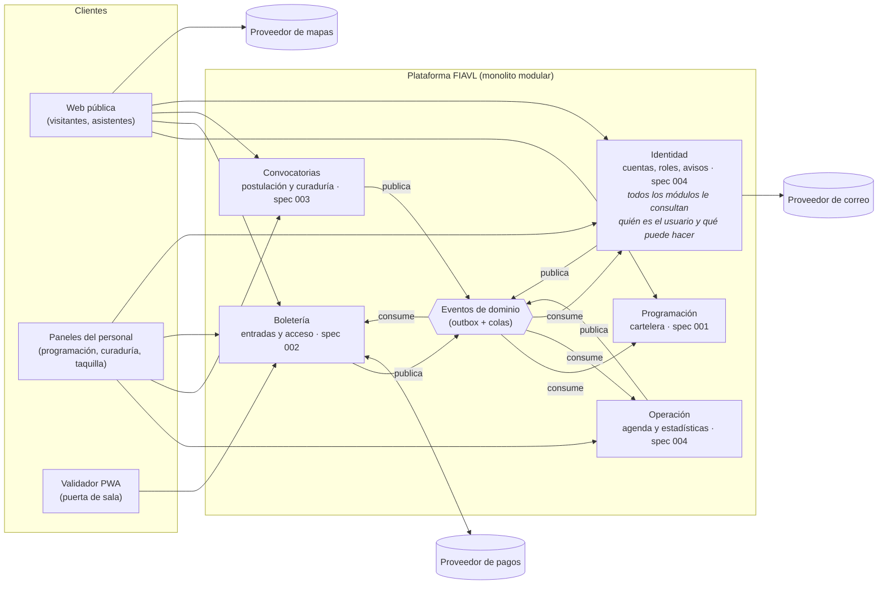
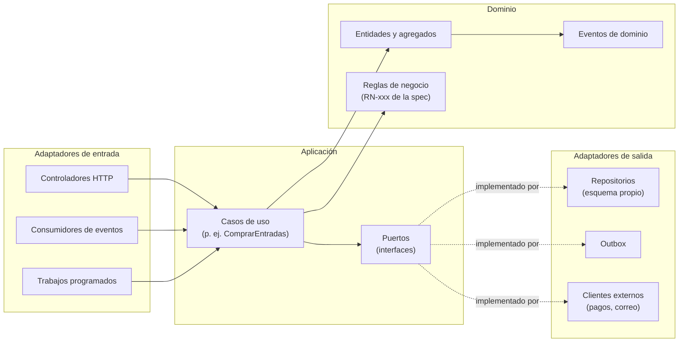
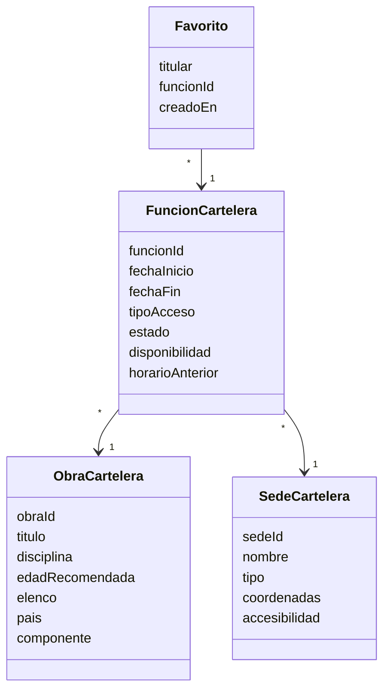
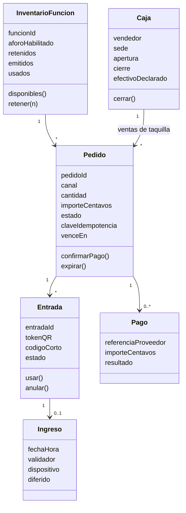
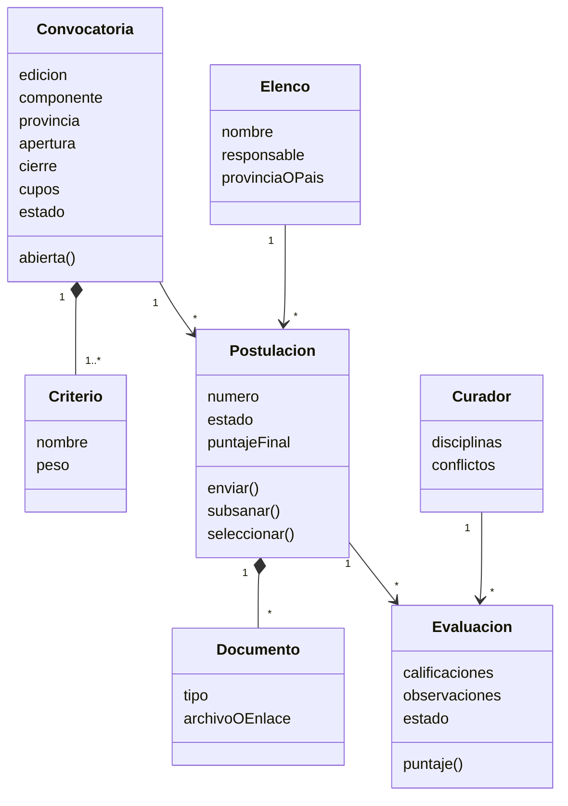
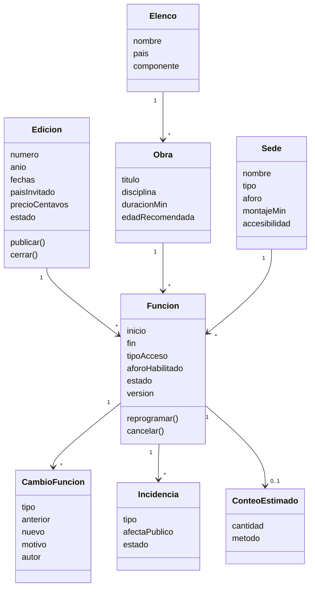
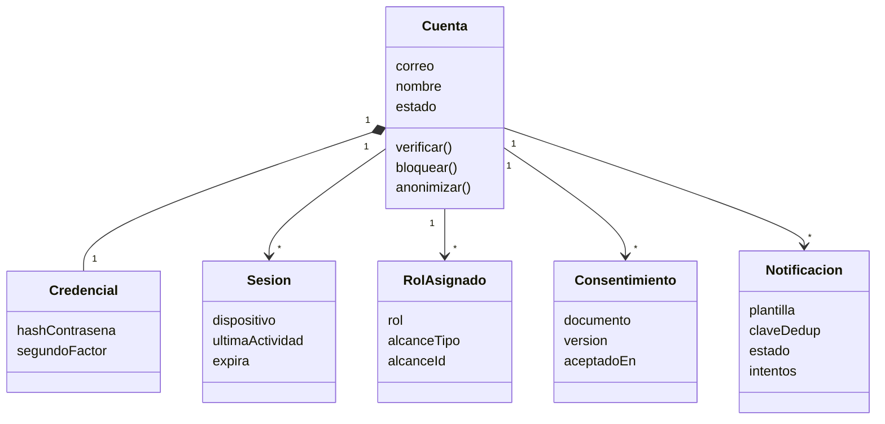

# Vista lógica

Describe **qué** hace el sistema en términos del dominio del festival: los módulos, sus
responsabilidades, cómo se comunican y los conceptos de cada uno. Base: [`docs/dominio.md`](../dominio.md).

## 1. Módulos y dependencias

| Módulo | Responsabilidad | Dueño de | No hace |
|--------|-----------------|----------|---------|
| Programación | Publicar la cartelera y la agenda personal | Proyección de lectura de funciones, favoritos | No crea funciones (solo las refleja) |
| Boletería | Vender, reservar, validar, devolver | Inventario, pedidos, entradas, ingresos, pagos, cajas | No decide horarios ni aforos |
| Convocatorias | Recibir y evaluar postulaciones | Convocatorias, postulaciones, evaluaciones, curadores | No programa funciones |
| Operación | Armar y cambiar la agenda; rendir cuentas | Ediciones, sedes, obras, elencos, funciones, incidencias, indicadores | No cobra ni envía correos |
| Identidad | Identificar, autorizar y avisar | Cuentas, roles, sesiones, consentimientos, notificaciones | No conoce reglas de negocio de otros módulos |

## 2. Estructura interna de cada módulo (hexagonal)

Todos los módulos siguen la misma forma; el dominio no depende de frameworks ni de la base de datos.

## 3. Modelo de cada contexto

### Programación (proyección de lectura)

### Boletería

### Convocatorias

### Operación

### Identidad

## 4. Contratos entre módulos

| Contrato | Tipo | Proveedor | Consumidores | Ubicación |
|----------|------|-----------|--------------|-----------|
| API pública de cartelera | HTTP (lectura) | Programación | Web pública | `specs/001-*/contracts/` |
| API de boletería | HTTP | Boletería | Web, taquilla, validador | `specs/002-*/contracts/` |
| API de convocatorias | HTTP | Convocatorias | Web, paneles | `specs/003-*/contracts/` |
| API de operación | HTTP | Operación | Paneles | `specs/004-*/contracts/` |
| `AutorizacionPort` | Interfaz interna | Identidad | Todos | `packages/contracts` |
| Eventos de dominio | Mensajes versionados | Cada módulo | Ver catálogo | `packages/contracts/eventos` |

Todo evento lleva `id`, `tipo`, `version`, `ocurridoEn`, `edicionId` y `correlacionId`.
