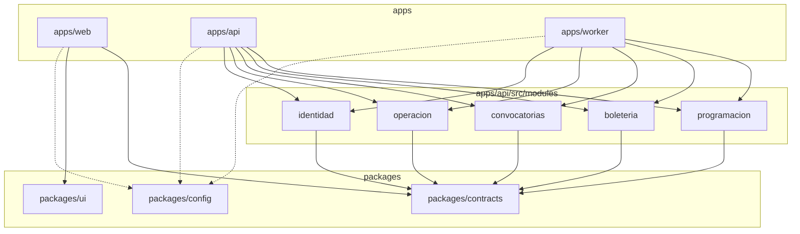
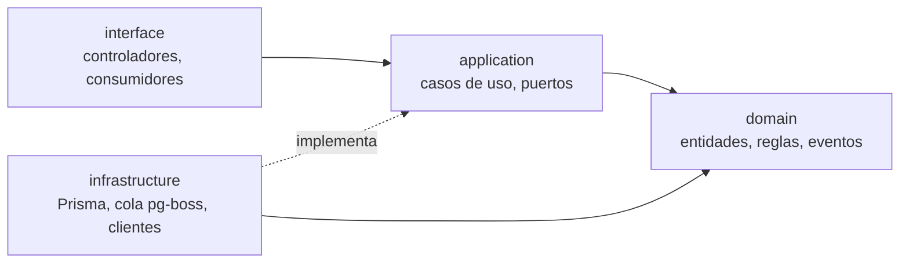
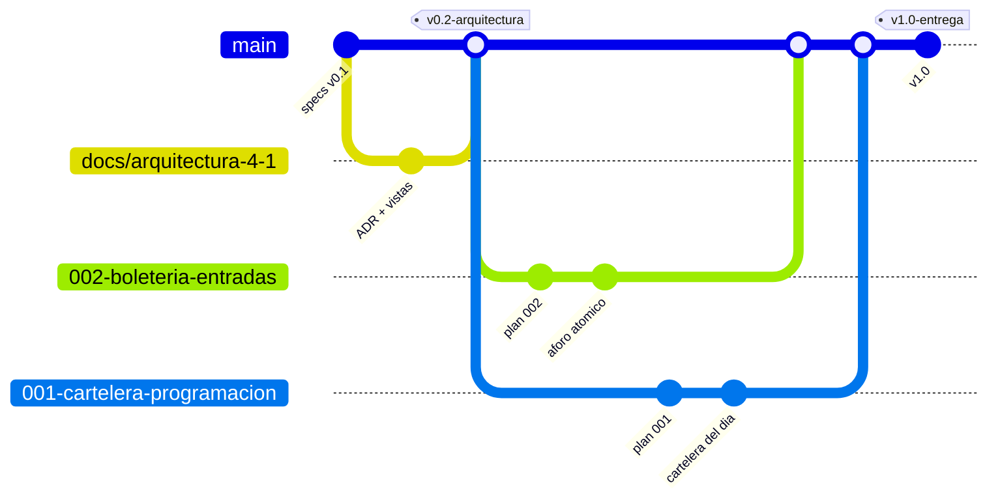
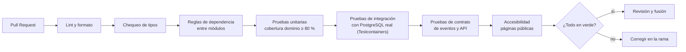

# Vista de desarrollo

Describe cómo se **organiza el código**, quién es dueño de cada parte, qué puede depender de qué
y cómo el equipo integra su trabajo. Tecnología según [ADR-0002](../adr/0002-stack-por-necesidades.md).

## 1. Estructura del monorepo

```
festival-artes-vivas-loja/
├── apps/
│   ├── api/                      # NestJS: HTTP + arranque de módulos
│   │   └── src/modules/
│   │       ├── programacion/     # spec 001
│   │       ├── boleteria/        # spec 002
│   │       ├── convocatorias/    # spec 003
│   │       ├── operacion/        # spec 004 (A)
│   │       └── identidad/        # spec 004 (B)
│   │           ├── domain/       # entidades, reglas, eventos (sin frameworks)
│   │           ├── application/  # casos de uso y puertos
│   │           ├── infrastructure/ # repositorios, cola de eventos, clientes externos
│   │           └── interface/    # controladores HTTP, consumidores, trabajos
│   ├── worker/                   # mismo código, arranca consumidores de colas y trabajos
│   └── web/                      # Next.js: cartelera, paneles y validador PWA
│       └── src/app/
│           ├── (publico)/        # cartelera, fichas, convocatorias abiertas, mis entradas
│           ├── (panel)/          # programación, curaduría, taquilla, estadísticas
│           └── validador/        # PWA con service worker
├── packages/
│   ├── contracts/                # DTO, eventos versionados, AutorizacionPort
│   ├── ui/                       # componentes accesibles compartidos
│   └── config/                   # eslint, tsconfig, prettier
├── prisma/                       # un esquema por módulo
├── docker/                       # docker-compose y Dockerfiles
├── docs/                         # arquitectura 4+1, ADR, dominio, investigación
└── specs/                        # spec-kit: spec, plan, tasks, contratos
```

## 2. Paquetes y dependencias permitidas



**Reglas de dependencia** (verificadas en la CI con `eslint-plugin-boundaries` o `dependency-cruiser`):

1. Un módulo **no importa** código de otro módulo; solo de `packages/contracts`.
2. Dentro de un módulo: `interface → application → domain`; `infrastructure` implementa los puertos
   de `application`. `domain` no importa nada externo.
3. `apps/web` solo habla con el API por HTTP usando los tipos de `packages/contracts`.
4. Cada módulo solo accede a su esquema de PostgreSQL (`programacion`, `boleteria`,
   `convocatorias`, `operacion`, `identidad`).



## 3. Responsables

| Área | Spec | Responsable (propuesta) | Revisor suplente |
|------|------|-------------------------|------------------|
| `modules/programacion` + `web/(publico)` | 001 | @jeimytorresg | @Kevrc |
| `modules/boleteria` + `web/validador` + taquilla | 002 | @By-Alvarez06 | @jeimytorresg |
| `modules/convocatorias` + curaduría | 003 | @Carlos2190 | @By-Alvarez06 |
| `modules/operacion` + `modules/identidad` + estadísticas | 004 | @Kevrc | @Carlos2190 |
| `packages/*`, `docker/`, CI, `docs/arquitectura` | transversal | rotativo | todos |

Cada integrante construye **su módulo de punta a punta** (dominio, API y pantallas), así todos
tienen commits en backend, frontend y documentación.

## 4. Flujo de ramas



- `main` protegida: PR con 1 aprobación (2 en Boletería e Identidad), historial lineal, sin *force push*.
- Una rama por spec (`001-…` a `004-…`); cambios compartidos en ramas `docs/…` o `chore/…`.
- Commits en español con Conventional Commits, ámbito = módulo.

## 5. Integración continua



Corresponde a las puertas de calidad Q1–Q8 de la constitución.
