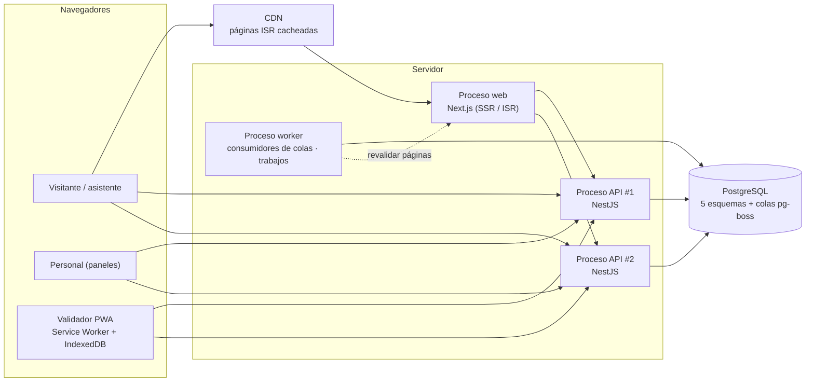
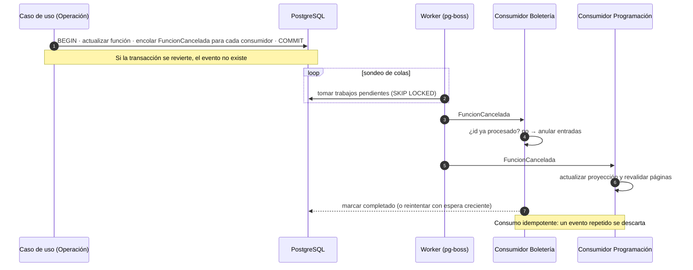
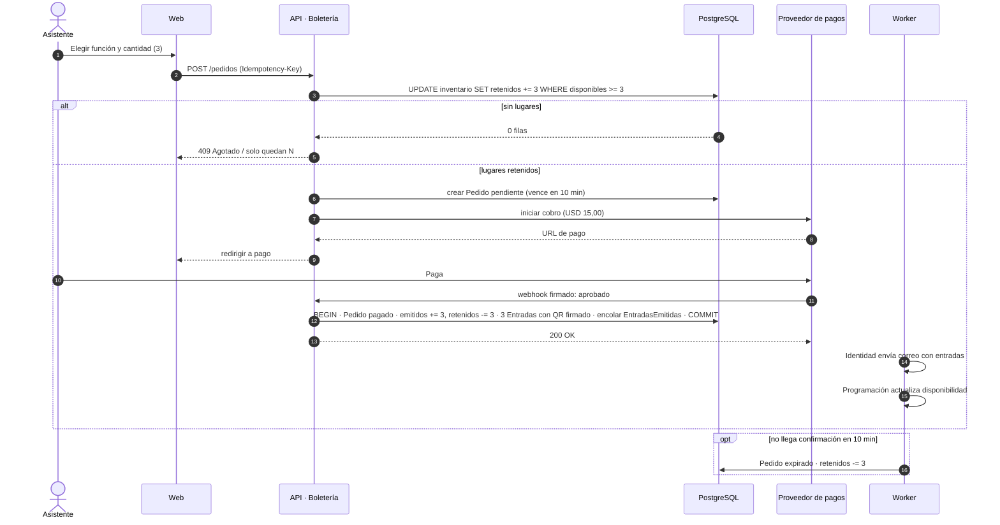
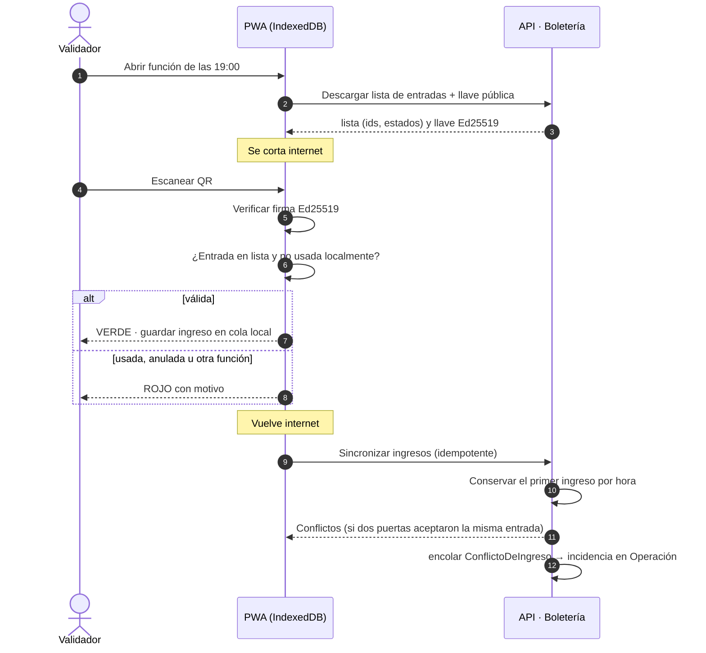
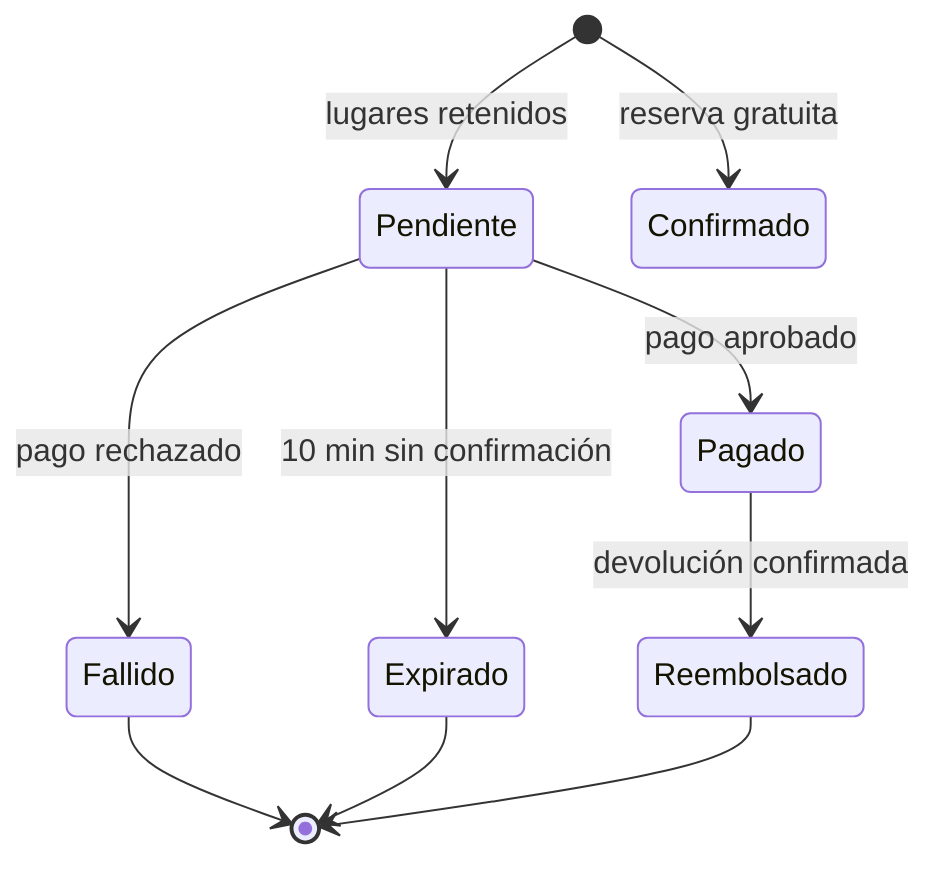
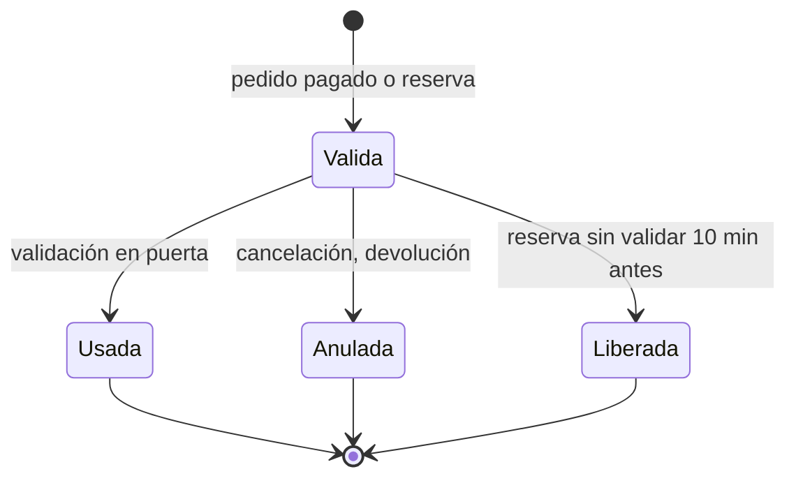
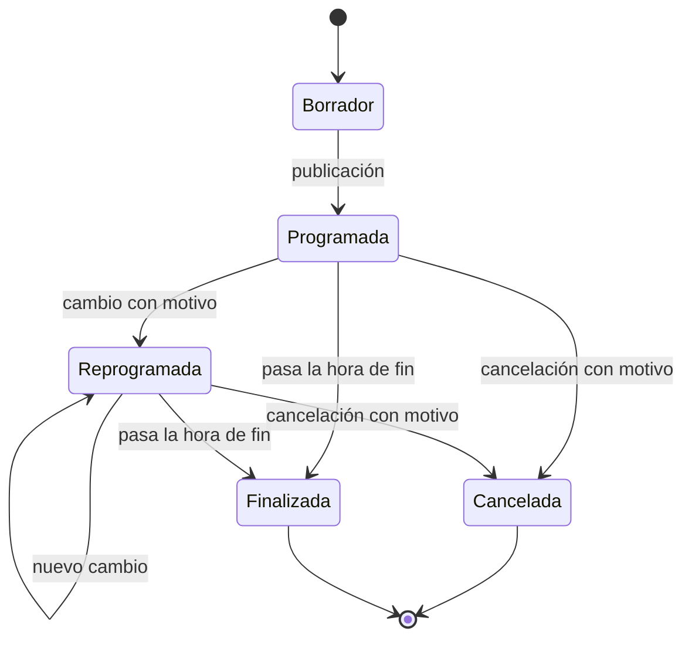
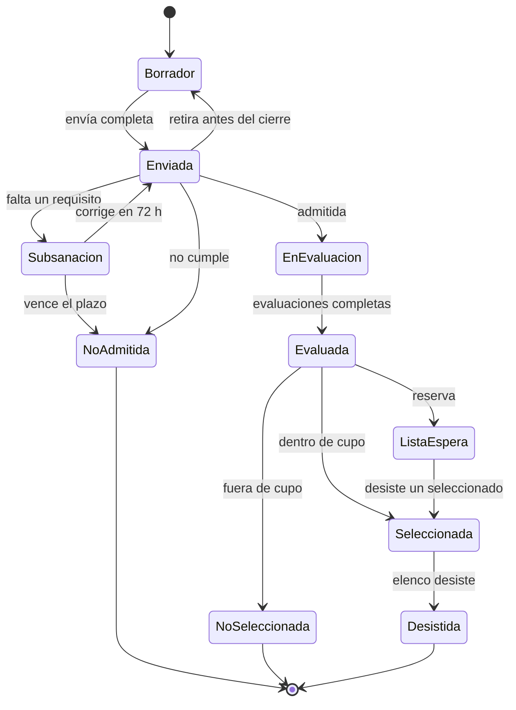
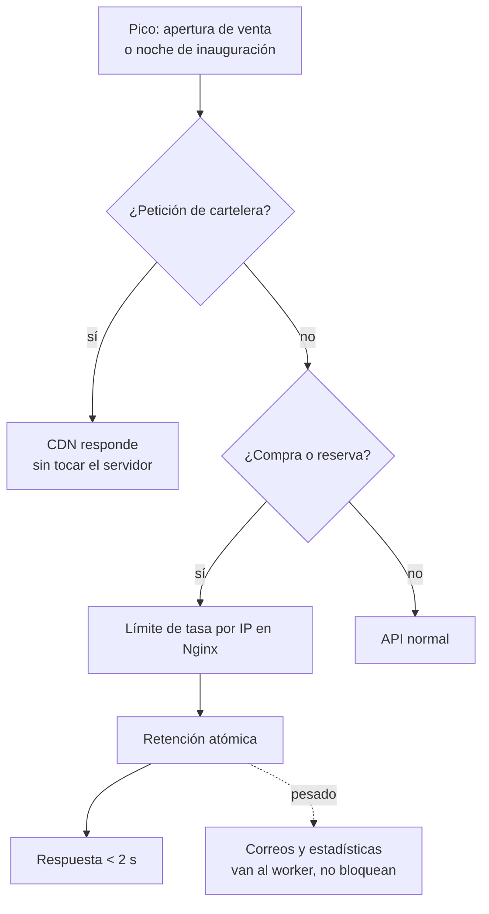

# Vista de procesos

Describe lo que ocurre **en tiempo de ejecución**: los procesos, cómo se comunican, cómo se
resuelve la concurrencia y cómo se comporta el sistema en los picos del festival.

## 1. Procesos en ejecución

| Proceso | Instancias | Hace | Si falla |
|---------|-----------|------|----------|
| web | 1+ | Renderiza cartelera y paneles | La CDN sigue sirviendo la última versión |
| api | 2+ | Atiende peticiones HTTP; escribe datos y encola eventos en la misma transacción | La otra réplica atiende |
| worker | 1 | Consume colas, ejecuta trabajos programados | Los eventos esperan en la cola; nada se pierde |
| validador | 1 por puerta | Valida QR localmente | Sigue sin red; sincroniza al volver |

### Trabajos programados (worker)

| Trabajo | Frecuencia | Spec |
|---------|-----------|------|
| Liberar retenciones vencidas (10 min) | cada 30 s | 002 FR-004 |
| Liberar reservas no validadas (10 min antes) | cada minuto | 002 FR-013 |
| Conciliar pagos pendientes | cada 2 min | ADR-0007 |
| Marcar funciones finalizadas | cada 5 min | 004 ciclo de función |
| Recalcular indicadores | cada 5 min en festival | 004 RNF-003 |
| Reintentar notificaciones fallidas | espera creciente hasta 24 h | 004 US10 |
| Cerrar edición | diario | 004 RN-007 |

## 2. Eventos de dominio: cola transaccional ([ADR-0003](../adr/0003-eventos-outbox.md))

## 3. Compra de entradas (spec 002, US1)

## 4. Validación de ingreso sin conexión (spec 002, US2)

## 5. Ciclos de vida

### Pedido (Boletería)

### Entrada (Boletería)

### Función (Operación)

### Postulación (Convocatorias)

## 6. Concurrencia y consistencia

| Situación | Riesgo | Solución |
|-----------|--------|----------|
| Web y taquilla venden el último lugar | Sobreventa | `UPDATE` atómico condicional ([ADR-0004](../adr/0004-control-de-aforo.md)) |
| Doble clic en "pagar" o reintento | Cobro o pedido duplicado | Clave de idempotencia única por pedido |
| Webhook de pago repetido | Entradas duplicadas | Procesamiento idempotente por referencia del proveedor |
| Dos programadores editan la misma función | Sobrescritura silenciosa | Bloqueo optimista con campo `version` |
| Evento entregado dos veces | Acción repetida | Consumidores registran ids procesados |
| Dos validadores sin red aceptan el mismo QR | Doble ingreso | Primer ingreso gana, conflicto alertado |
| Asignación de curadores concurrente | Carga desbalanceada | Transacción serializable en la asignación |

## 7. Comportamiento en picos

| Momento | Carga esperada | Táctica |
|---------|----------------|---------|
| Apertura de venta | Ráfagas de compra sobre pocas funciones | Retención atómica, límite de tasa, cola de correos |
| Inauguración y clausura | Miles consultando la cartelera a la vez | CDN + ISR, disponibilidad aparte cada 15 s |
| Entrada a sala | 300 personas en 15 min por sala | Validación local en la PWA |
| Cierre de convocatoria | ~500 envíos por hora | Borradores guardados, subida de archivos directa al almacenamiento |
