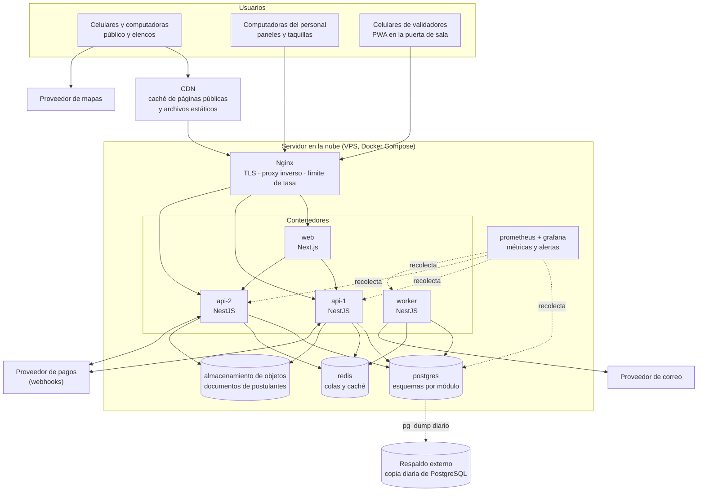
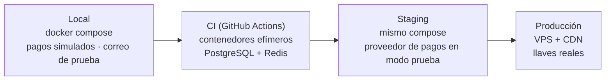

# Vista física

Describe **dónde** se ejecuta cada proceso, cómo se conectan los nodos y cómo se dimensiona para
el festival. Decisión base: [ADR-0008](../adr/0008-despliegue-contenedores.md).

## 1. Diagrama de despliegue (producción)

## 2. Nodos y contenedores

| Nodo / contenedor | Imagen | Recursos (festival) | Puertos | Notas |
|-------------------|--------|---------------------|---------|-------|
| nginx | `nginx` | 0,5 vCPU · 256 MB | 443 público | Único punto expuesto a internet |
| web | `apps/web` | 1 vCPU · 1 GB | 3000 interno | ISR; la CDN absorbe la mayoría de visitas |
| api-1, api-2 | `apps/api` | 1 vCPU · 1 GB c/u | 4000 interno | Sin estado; se pueden añadir más réplicas |
| worker | `apps/worker` | 1 vCPU · 1 GB | — | Una sola instancia (los trabajos programados no se duplican) |
| postgres | `postgres:16` | 2 vCPU · 4 GB | 5432 interno | Volumen persistente, respaldo diario |
| redis | `redis:7` | 0,5 vCPU · 512 MB | 6379 interno | Persistencia AOF para no perder colas |
| almacenamiento | MinIO o S3 | — | interno | Archivos privados con URLs firmadas temporales |
| monitoreo | prometheus + grafana | 0,5 vCPU · 512 MB | interno | Paneles de errores, latencia, entradas por función |

Total aproximado en festival: **8 vCPU y 10 GB de RAM** en un VPS; fuera del festival se reduce a
una réplica del API.

## 3. Entornos

| Entorno | Datos | Pagos | Correo | Quién despliega |
|---------|-------|-------|--------|-----------------|
| Local | Semilla con la edición 2026 (obras y sedes reales) | Adaptador simulado | Buzón de prueba local | Cada integrante |
| CI | Efímeros por ejecución | Simulado | Simulado | Automático en cada PR |
| Staging | Copia anonimizada | Modo prueba del proveedor | Proveedor real a direcciones de prueba | Al fusionar en `main` |
| Producción | Reales | Real | Real | Etiqueta de versión aprobada |

## 4. Seguridad de la infraestructura

- Solo Nginx expone puertos; el resto vive en una red interna de Docker.
- TLS en todo el tráfico externo; HSTS activado.
- Secretos (llave privada Ed25519, llaves del proveedor de pagos, contraseña de base de datos) en
  variables de entorno del servidor o un gestor de secretos, nunca en el repositorio.
- Los webhooks de pagos se verifican por firma y se limitan a las IP del proveedor.
- Los documentos de postulantes se sirven con URLs firmadas que caducan en 5 minutos.
- Respaldo diario cifrado fuera del servidor; prueba de restauración antes del festival.

## 5. Riesgos físicos aceptados

| Riesgo | Impacto | Mitigación |
|--------|---------|------------|
| Caída del VPS | Se detiene todo salvo la cartelera en CDN y los validadores sin red | Respaldo diario, procedimiento de restauración documentado |
| Internet inestable en salas | Validación en la puerta | PWA sin conexión (ADR-0005) |
| Caída del proveedor de pagos | No hay venta en línea | Taquilla en efectivo sigue operando |
