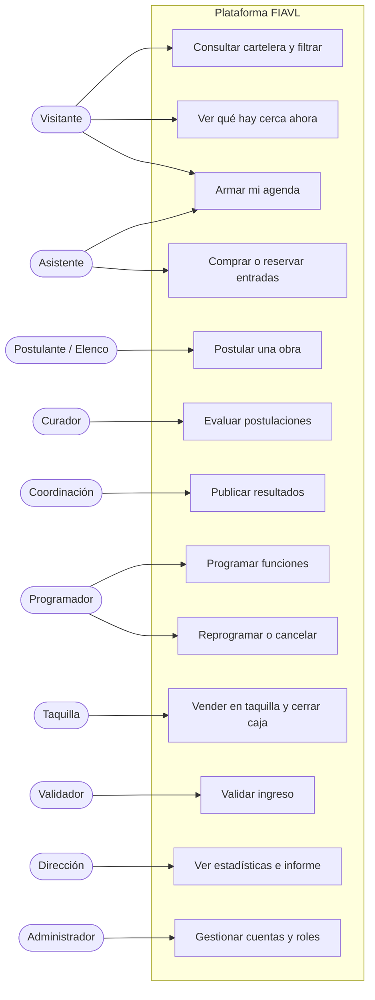
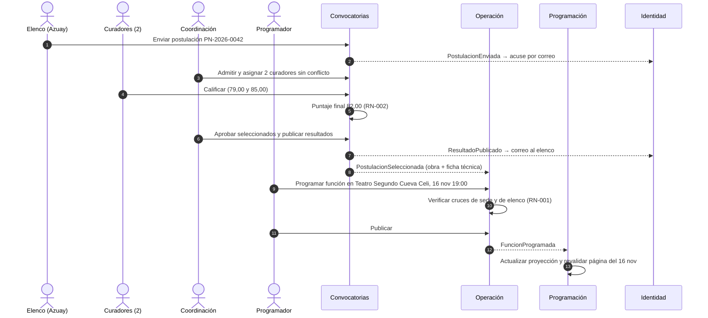
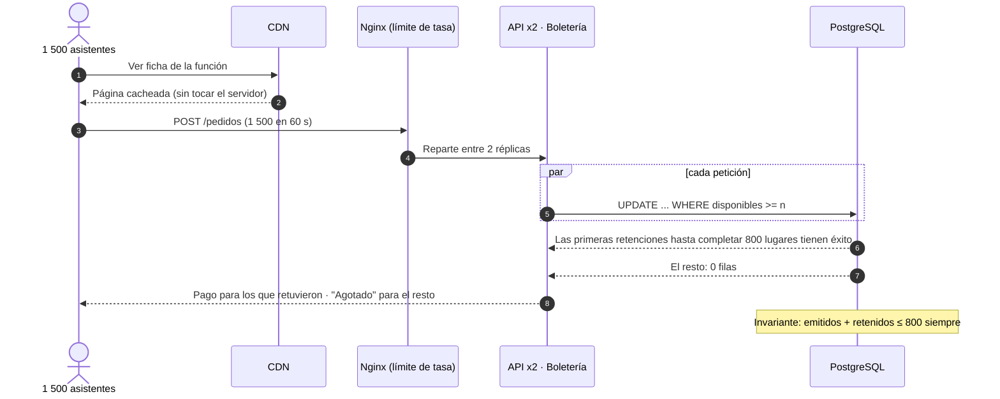
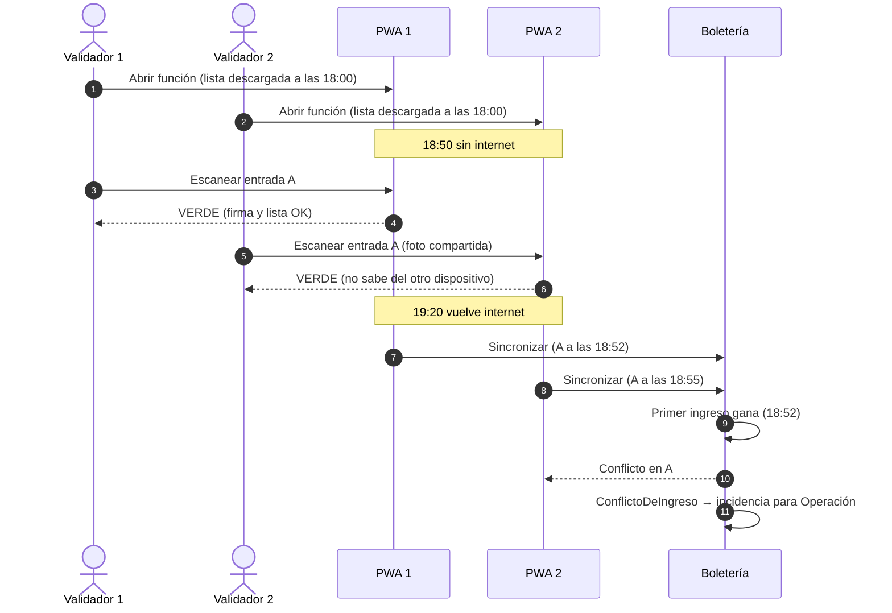
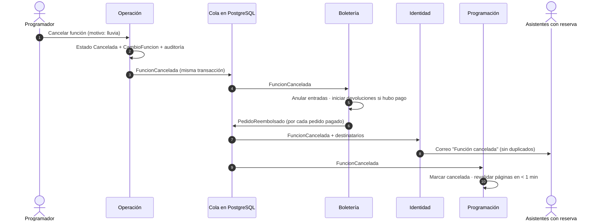

# Vista de escenarios (+1)

Los escenarios unen las otras cuatro vistas: cada uno recorre módulos (lógica), código y dueños
(desarrollo), procesos y eventos (procesos) y nodos (física). Se derivan de las historias **P1**
de las specs y son el guion de la demostración del video.

## 1. Casos de uso por actor

## 2. Escenarios y cobertura de vistas

| # | Escenario | Historias | Lógica | Desarrollo | Procesos | Física |
|---|-----------|-----------|:------:|:----------:|:--------:|:------:|
| E1 | De la convocatoria a la cartelera | 003-US1, 003-US3, 003-US4, 004-US1, 004-US2, 001-US1 | ● | ● | ● | ○ |
| E2 | Compra en hora pico sin sobreventa | 001-US1, 002-US1 | ● | ○ | ● | ● |
| E3 | Ingreso a sala sin internet | 002-US2 | ○ | ○ | ● | ● |
| E4 | Cancelación por lluvia | 004-US3, 002-US5, 004-US10, 001-US1 | ● | ○ | ● | ○ |

### E1 — De la convocatoria a la cartelera

Una compañía de Azuay postula, es evaluada por dos curadores, queda seleccionada y su función
aparece en la cartelera.

**Valida**: fronteras entre módulos por eventos (ADR-0003), cálculo de puntajes, regla de cruces,
proyección de lectura de la cartelera.

### E2 — Compra en hora pico sin sobreventa

Se abre la venta de "La Artista" (Los Nadies Circo, Chile), Teatro Nacional, aforo habilitado 800.
En el primer minuto llegan 1 500 intentos de compra.

**Valida**: ADR-0004, ADR-0006, ADR-0008; SC-001 de la spec 002 (cero sobreventa).

### E3 — Ingreso a sala sin internet

Teatro Bolívar, "Zombi Manifiesto", 300 entradas, 3 validadores; se cae el wifi a las 18:50.

**Valida**: ADR-0005, riesgo aceptado y detectado; SC-003 de la spec 002.

### E4 — Cancelación por lluvia

Una función al aire libre con reserva se cancela a las 16:00 por tormenta.

**Valida**: ADR-0003 (sin pérdida de eventos), consistencia eventual dentro de 1 minuto,
idempotencia de notificaciones.

## 3. Guion de demostración para el video

El guion completo, con el texto de cada integrante y lo que se muestra en pantalla, está en
[guion-video.md](../guion-video.md).
