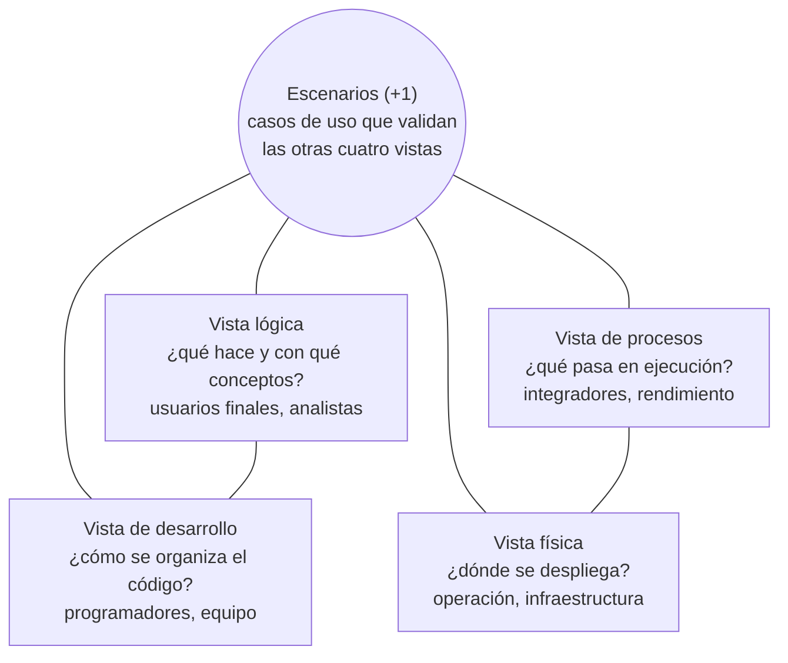

# Arquitectura 4+1 — Plataforma del FIAVL

Arquitectura documentada con el modelo de vistas de **Kruchten (4+1)**. Todos los diagramas están
en Mermaid y se ven directamente en GitHub. Las decisiones que la sostienen están en
[`docs/adr/`](../adr/) y **cada una se justifica con un driver** de [00-drivers.md](00-drivers.md).

| Vista | Documento | Contenido principal |
|-------|-----------|---------------------|
| (base) | [00-drivers.md](00-drivers.md) | Restricciones, escenarios de calidad, dimensionamiento y matriz drivers → decisiones |
| Lógica | [01-vista-logica.md](01-vista-logica.md) | Contextos, módulos, puertos, modelo de cada contexto |
| Desarrollo | [02-vista-desarrollo.md](02-vista-desarrollo.md) | Monorepo, paquetes, reglas de dependencia, dueños, ramas, CI |
| Procesos | [03-vista-procesos.md](03-vista-procesos.md) | Procesos en ejecución, eventos, concurrencia, secuencias y estados |
| Física | [04-vista-fisica.md](04-vista-fisica.md) | Nodos, despliegue, entornos, capacidad |
| Escenarios | [05-vista-escenarios.md](05-vista-escenarios.md) | Casos de uso y 4 escenarios de extremo a extremo |

## Resumen de la arquitectura

- **Estilo**: monolito modular con cinco módulos de dominio ([ADR-0001](../adr/0001-monolito-modular.md)),
  cada uno con arquitectura hexagonal (dominio, aplicación, adaptadores).
- **Integración**: eventos de dominio en una cola transaccional sobre PostgreSQL ([ADR-0003](../adr/0003-eventos-outbox.md)).
- **Tecnología**: elegida por necesidad con matrices de criterios — NestJS, Next.js, PostgreSQL ([ADR-0002](../adr/0002-stack-por-necesidades.md)).
- **Calidades críticas**: sin sobreventa ([ADR-0004](../adr/0004-control-de-aforo.md)), ingreso sin
  conexión ([ADR-0005](../adr/0005-qr-firmado-validador-offline.md)), cartelera resistente a picos
  ([ADR-0006](../adr/0006-cartelera-en-cache.md)), pagos desacoplados
  ([ADR-0007](../adr/0007-pagos-capa-anticorrupcion.md)), despliegue en contenedores
  ([ADR-0008](../adr/0008-despliegue-contenedores.md)).

## Atributos de calidad y dónde se resuelven

| Atributo | Objetivo (constitución / specs) | Táctica | Vista |
|----------|--------------------------------|---------|-------|
| Integridad del aforo | 0 sobreventa con 500 compras concurrentes | Actualización atómica condicional, idempotencia | Procesos |
| Rendimiento | Cartelera < 3 s en 4G, 5 000 usuarios | CDN + ISR + proyección de lectura | Procesos, física |
| Disponibilidad | La cartelera sigue si Boletería cae | Caché, módulos aislados por eventos | Procesos, física |
| Operación sin red | Validación < 2 s sin internet | QR firmado Ed25519 + PWA con lista local | Procesos, física |
| Seguridad | Autorización por rol y alcance en servidor | Guardas por rol, 2FA para personal, secretos fuera del repo | Lógica, física |
| Mantenibilidad | 4 integrantes en paralelo | Un módulo por integrante, contratos compartidos | Desarrollo |
| Trazabilidad | Auditoría de decisiones y cambios | Bitácora inmutable, id de correlación | Lógica, procesos |
