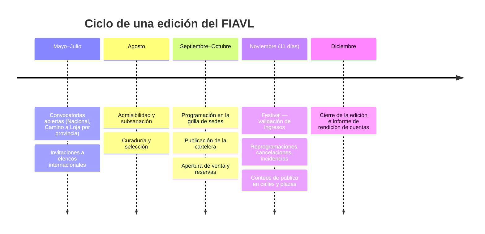
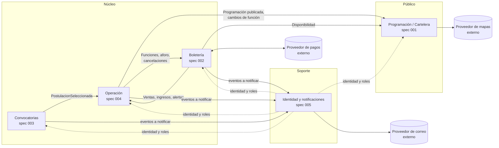

# Modelo del dominio: FIAVL

Visión común para todas las specs: contextos, cómo se relacionan, el lenguaje compartido y el
catálogo de eventos. Es la base de la **vista lógica** del modelo 4+1.

## 1. Ciclo anual de una edición

## 2. Mapa de contextos

| Relación | Tipo | Nota |
|----------|------|------|
| Convocatorias → Operación | Cliente–proveedor, por eventos | Operación adopta la ficha de obra tal cual |
| Operación → Cartelera / Boletería | Publicador–suscriptor | Operación es la fuente de verdad de funciones |
| Boletería → Cartelera | Publicador–suscriptor | Solo la disponibilidad, no los pedidos |
| Boletería ↔ Pagos | Capa anticorrupción | El modelo del proveedor no entra al dominio |
| Identidad → todos | Núcleo compartido mínimo | Solo identidad, roles y alcance |

## 3. Lenguaje ubicuo (glosario)

| Término | Significado |
|---------|-------------|
| Edición | Un año del festival (p. ej. XI, 2026), con sus fechas, país invitado y precio |
| Componente | Línea de programación: Internacional, Nacional, Camino a Loja, Escuela del festival, Salud + Arte |
| *In* / *Off* | Programación curada en salas / programación en calles, plazas y parques |
| Elenco | Agrupación o artista que presenta una o más obras |
| Obra | Pieza artística con duración, disciplina y ficha técnica |
| Función | Una presentación de una obra en una sede, en un horario |
| Sede | Lugar de presentación: teatro, centro cultural, museo, espacio público o recorrido |
| Aforo | Capacidad máxima de la sede |
| Aforo habilitado | Capacidad que se ofrece para una función (≤ aforo) |
| Tipo de acceso | Pagada · gratuita con reserva · gratuita libre · público restringido |
| Entrada | Derecho de ingreso a una función, con QR de un solo uso |
| Reserva | Entrada sin costo para una función gratuita con aforo |
| Ingreso | Validación de una entrada en la puerta |
| Taquilla | Punto de venta presencial en una sede |
| Convocatoria | Llamado público a postular obras para una edición y componente |
| Postulación | Propuesta de un elenco a una convocatoria |
| Subsanación | Corrección de requisitos formales dentro de un plazo |
| Curador | Evaluador experto que califica postulaciones |
| Cupo | Número de obras seleccionables por convocatoria, disciplina o provincia |
| Lista de espera | Postulaciones que pasan a seleccionadas si alguien desiste |
| Camino a Loja | Programa de la Casa de la Cultura que lleva obras de las 24 provincias al festival |
| Conteo estimado | Asistencia aproximada en una función de acceso libre |
| Informe de cierre | Rendición de cuentas de la edición (actividades, asistencia, ocupación) |

## 4. Catálogo de eventos de dominio

| Evento | Publica | Consumen |
|--------|---------|----------|
| `ConvocatoriaPublicada` | Convocatorias | Cartelera |
| `PostulacionEnviada` | Convocatorias | Identidad |
| `SubsanacionSolicitada` | Convocatorias | Identidad |
| `ResultadoPublicado` | Convocatorias | Identidad |
| `PostulacionSeleccionada` | Convocatorias | Operación |
| `SeleccionDesistida` | Convocatorias | Operación |
| `ProgramacionPublicada` | Operación | Cartelera, Boletería |
| `FuncionProgramada` / `FuncionActualizada` | Operación | Cartelera, Boletería |
| `FuncionReprogramada` | Operación | Cartelera, Boletería, Identidad |
| `FuncionCancelada` | Operación | Cartelera, Boletería, Identidad |
| `AforoCambiado` | Operación | Boletería |
| `DisponibilidadCambiada` | Boletería | Cartelera |
| `EntradasEmitidas` | Boletería | Operación, Identidad |
| `IngresoRegistrado` | Boletería | Operación |
| `PedidoReembolsado` | Boletería | Operación, Identidad |
| `AforoExcedido` / `ConflictoDeIngreso` | Boletería | Operación |
| `CuentaVerificada` / `RolAsignado` / `CuentaEliminada` | Identidad | Todos |

Todo evento lleva: identificador único, tipo, versión, fecha, edición e identificador de
correlación (Constitución IX). Los consumidores son idempotentes ante eventos repetidos.

## 5. Escenarios candidatos para la vista +1

Historias P1 que recorren varios contextos y sirven para validar la arquitectura y para el video:

1. **De la convocatoria a la cartelera**: 003-US1 → 003-US3 → 003-US4 → 004-US1 → 004-US2 → 001-US1.
2. **Compra en hora pico sin sobreventa**: 001-US1 → 002-US1 (500 compras concurrentes, 100 lugares).
3. **Ingreso sin internet**: 002-US2 (validación diferida y conflicto de doble ingreso).
4. **Cancelación por lluvia**: 004-US3 → 002-US5 → 005-US4 → 001-US1.
