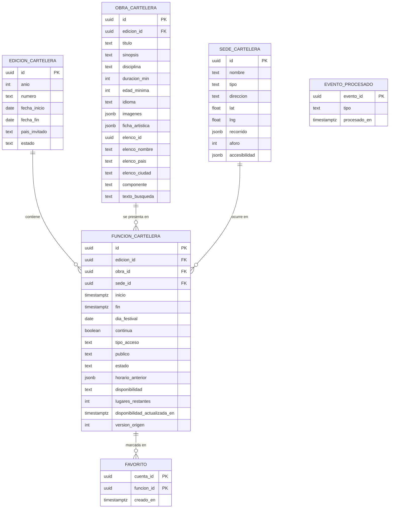
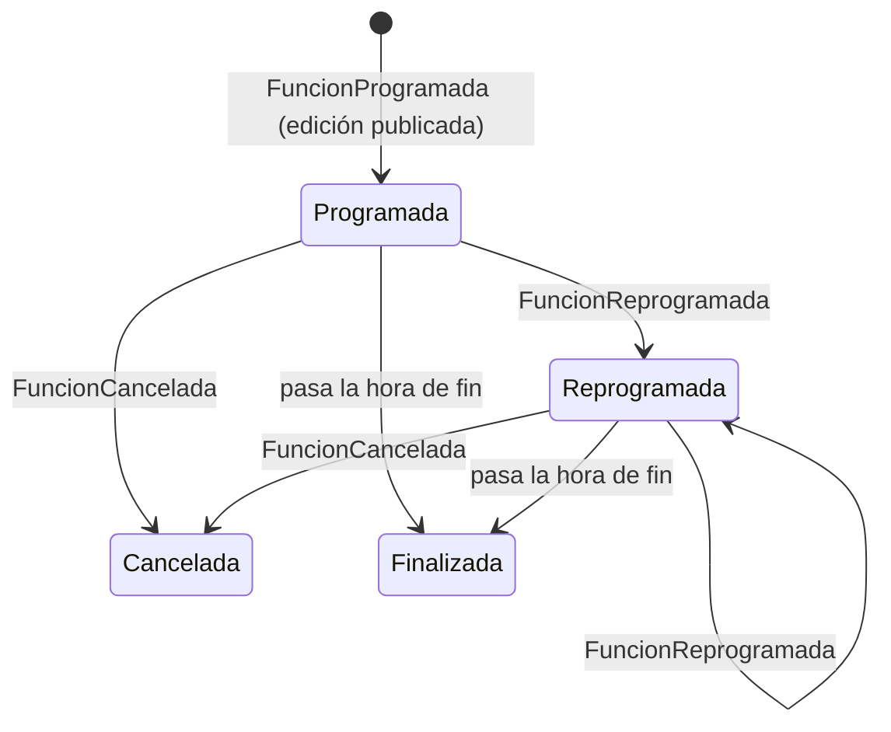

# Data Model: Cartelera pública de programación (001)

Esquema PostgreSQL **`programacion`**, propiedad exclusiva de este módulo (constitución III).
Casi todo es una **proyección de lectura** alimentada por eventos de Operación (004) y Boletería
(002); la única escritura propia del usuario son los **favoritos**.

## Entidades

### `edicion_cartelera`
| Campo | Tipo | Regla |
|-------|------|-------|
| `estado` | `borrador` \| `publicada` \| `cerrada` | Solo `publicada` y `cerrada` son visibles (RN-001) |
| `fecha_inicio`, `fecha_fin` | date | Definen los días navegables |

### `obra_cartelera`
Desnormaliza los datos del **elenco** para no consultar a Operación al servir la cartelera.

| Campo | Regla |
|-------|-------|
| `disciplina` | `teatro` \| `danza` \| `circo` \| `musica` \| `titeres` \| `exposicion` \| `taller` \| `calle` \| `cine` |
| `componente` | `internacional` \| `nacional` \| `camino_a_loja` \| `escuela` \| `salud_arte` |
| `edad_minima` | 0 = todo público; se destaca si ≥ 16 (US3-AS3) |
| `texto_busqueda` | **Columna generada**: `lower(unaccent(titulo \|\| ' ' \|\| elenco_nombre))`, índice GIN `gin_trgm_ops` (research R2) |
| `imagenes` | Lista de URLs; vacía → marcador de la disciplina (caso borde) |

### `sede_cartelera`
| Campo | Regla |
|-------|-------|
| `tipo` | `teatro` \| `centro_cultural` \| `museo` \| `espacio_publico` \| `recorrido` |
| `recorrido` | Lista ordenada de puntos `{lat, lng, nombre}`; solo para `tipo = recorrido` (desfile) |
| `accesibilidad` | `{silla_ruedas, bano_accesible, rampa, ...}`; ausente → "sin información" (US3-AS2) |

### `funcion_cartelera`
| Campo | Regla |
|-------|-------|
| `dia_festival` | `(inicio AT TIME ZONE 'America/Guayaquil')::date` (research R3) |
| `continua` | `true` para exposiciones de varios días: se muestran una vez por día como actividad continua |
| `tipo_acceso` | `pagada` \| `gratuita_reserva` \| `gratuita_libre` \| `restringida` |
| `publico` | `familiar` \| `adultos` \| `estudiantes` |
| `estado` | `programada` \| `reprogramada` \| `cancelada` \| `finalizada` |
| `horario_anterior` | `{inicio, fin, sede_id}` cuando `estado = reprogramada` (US1-AS4) |
| `disponibilidad` | `disponible` \| `ultimos_lugares` \| `agotado` \| `no_aplica` (libre) |
| `lugares_restantes` | Informado por Boletería; `ultimos_lugares` si ≤ 10 % del aforo habilitado (RN-002) |
| `version_origen` | Versión de la función en Operación; un evento con versión ≤ a la guardada se ignora (orden fuera de secuencia) |

**Índices**: `(edicion_id, dia_festival, inicio)` para el listado del día; `(inicio, fin)` para
"Ahora"; GIN trigram sobre `obra_cartelera.texto_busqueda`.

**Orden por defecto del día (RN-006)**: `inicio`, luego `sede.nombre`, luego `obra.titulo`.

### `favorito`
| Campo | Regla |
|-------|-------|
| `(cuenta_id, funcion_id)` | Clave primaria compuesta → la fusión no duplica (US5-AS3) |
| `cuenta_id` | Identificador de Identidad (004); sin clave foránea entre esquemas |

### `evento_procesado`
Registro de ids de eventos ya aplicados: hace **idempotentes** a los consumidores (ADR-0003).

## Estado derivado de una función en la cartelera

La disponibilidad es independiente del estado: una función `cancelada` siempre se muestra sin
opción de entrada, sin importar su disponibilidad (US1-AS3).

## Datos que viven solo en el navegador

| Dato | Dónde | Por qué |
|------|-------|---------|
| Favoritos sin cuenta | `localStorage` (`fiavl.favoritos`) | US5-AS3 |
| Posición del visitante | Memoria de la pestaña, nunca persistida ni enviada | FR-014 |
| Filtros activos | *Query string* de la URL | FR-005 (compartible) |

## Reglas como funciones puras (probadas en unitarias)

| Regla | Función |
|-------|---------|
| RN-002 últimos lugares | `nivelDisponibilidad(restantes, aforoHabilitado)` |
| RN-003 en curso | `enCurso(funcion, ahora)` |
| RN-004 traslado ajustado | `avisosAgenda(favoritas)` → cruces y traslados < 15 min |
| RN-006 orden | `ordenarDia(funciones)` |
| R3 día de festival | `diaFestival(inicio)` |
| R6 cercanía | `minutosAPie(origen, destino)` |
| FR-003 filtros | `aplicarFiltros(funciones, filtros)` |
