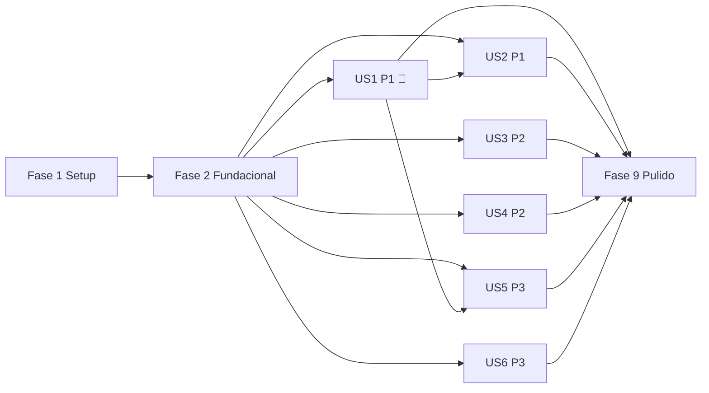

# Tasks: Cartelera pública de programación

**Input**: Documentos de diseño en `/specs/001-cartelera-programacion/`

**Prerequisites**: [plan.md](plan.md), [spec.md](spec.md), [research.md](research.md),
[data-model.md](data-model.md), [contracts/](contracts/), [quickstart.md](quickstart.md)

**Tests**: **Obligatorias** por la constitución (principio IV): cada escenario `USn-ASm` tiene al
menos una prueba con ese identificador en su nombre, y las reglas RN se escriben probando
primero (la prueba debe fallar antes de implementar).

**Organization**: Tareas agrupadas por historia de usuario para implementar y probar cada una
por separado.

## Format: `[ID] [P?] [Story] Description`

- **[P]**: Se puede hacer en paralelo (archivos distintos, sin dependencias pendientes)
- **[Story]**: Historia a la que pertenece (US1…US6)
- Rutas según la estructura de [plan.md](plan.md#project-structure)

## Path Conventions

- API: `apps/api/src/modules/programacion/` · pruebas de integración: `apps/api/test/programacion/`
- Web: `apps/web/src/app/(publico)/` · librería: `apps/web/src/lib/cartelera/` · E2E: `apps/web/e2e/`
- Contratos compartidos: `packages/contracts/` · esquema de datos: `prisma/programacion.prisma`

---

## Phase 1: Setup (infraestructura compartida del monorepo)

**Purpose**: Esta spec es la primera en implementarse; crea el esqueleto que reutilizan 002–004
(ver [plan.md](plan.md#project-structure)).

- [ ] T001 Crear el monorepo con pnpm workspaces y Turborepo en `package.json`, `pnpm-workspace.yaml` y `turbo.json` (tareas `dev`, `build`, `lint`, `typecheck`, `test`, `test:e2e`)
- [ ] T002 [P] Crear `packages/config/` con `tsconfig.base.json`, configuración de ESLint (incluida la regla de fronteras entre módulos de la [vista de desarrollo](../../docs/arquitectura/02-vista-desarrollo.md#2-paquetes-y-dependencias-permitidas)) y Prettier
- [ ] T003 [P] Crear `apps/api/` con NestJS 11 (`main.ts`, `app.module.ts`, carpeta `src/modules/`) y configuración de Vitest
- [ ] T004 [P] Crear `apps/web/` con Next.js 15 (App Router, grupo `(publico)`, `next.config.ts`) y configuración de Playwright en `apps/web/playwright.config.ts`
- [ ] T005 [P] Crear `apps/worker/src/main.ts` que arranca los mismos módulos del API sin HTTP (consumidores y trabajos, [ADR-0008](../../docs/adr/0008-despliegue-contenedores.md))
- [ ] T006 [P] Crear `packages/contracts/` con `package.json`, zod 3 y carpetas `api/` y `eventos/`
- [ ] T007 Crear `docker/docker-compose.yml` con PostgreSQL 16 y scripts `db:up`, `db:down` en `package.json` raíz
- [ ] T008 Configurar Prisma 6 con `multiSchema` en `prisma/schema.prisma` y scripts `db:migrate`, `db:seed`
- [ ] T009 [P] Configurar commitlint (Conventional Commits en español, ámbitos de la constitución §6) y husky en `commitlint.config.mjs`
- [ ] T010 Crear el workflow de CI en `.github/workflows/ci.yml`: lint, typecheck, pruebas unitarias con **umbral de cobertura ≥ 80 % en `**/domain/**`** (`@vitest/coverage-v8`, falla si no se alcanza), integración (con servicio PostgreSQL), contratos, E2E con axe y escaneo de secretos con gitleaks (puertas Q1–Q3, Q7 y Q8)
- [ ] T011 Crear el logger estructurado (nestjs-pino) con id de correlación por petición y el endpoint `/metrics` (prom-client) con peticiones, errores y latencia en `apps/api/src/common/observabilidad/` (constitución IX, research R12)

**Checkpoint**: `pnpm install && pnpm lint && pnpm test` pasa en local y en la CI con proyectos vacíos.

---

## Phase 2: Foundational (prerrequisitos que bloquean todas las historias)

**⚠️ CRITICAL**: Ninguna historia empieza hasta terminar esta fase.

### Pruebas primero (deben fallar)

- [ ] T012 [P] Prueba unitaria de `diaFestival` (incluye función que cruza medianoche y dispositivo en otra zona horaria) e `incluidaEnDia` (exposición continua del 12 al 22 aparece el 15) en `apps/api/src/modules/programacion/domain/dia-festival.test.ts` — `data-model.md` FuncionCartelera.dia_festival
- [ ] T013 [P] Pruebas de contrato con ejemplos válidos e inválidos de cada evento en `packages/contracts/eventos/eventos.test.ts` según [eventos-consumidos.md](contracts/eventos-consumidos.md)
- [ ] T014 [P] Prueba de integración de la proyección en `apps/api/test/programacion/proyeccion.int.test.ts`: evento repetido no duplica (`data-model.md` EventoProcesado.evento_id), versión antigua se ignora (`data-model.md` FuncionCartelera.version_origen), `FuncionReprogramada` guarda el horario anterior (`data-model.md` FuncionCartelera.horario_anterior)

### Implementación

- [ ] T015 Definir el esquema `programacion` en `prisma/programacion.prisma` con las entidades de [data-model.md](data-model.md): enumeraciones de `data-model.md` EdicionCartelera.estado, ObraCartelera.disciplina, ObraCartelera.componente, SedeCartelera.tipo, FuncionCartelera.tipo_acceso, FuncionCartelera.publico, FuncionCartelera.estado, FuncionCartelera.disponibilidad; campo `data-model.md` FuncionCartelera.aforo_habilitado; clave compuesta `data-model.md` Favorito.(cuenta_id, funcion_id); `data-model.md` EventoProcesado
- [ ] T016 Crear la migración SQL en `prisma/migrations/` que habilita `unaccent` y `pg_trgm`, la columna generada `data-model.md` ObraCartelera.texto_busqueda con índice GIN trigram, y los índices `(edicion_id, dia_festival, inicio)` e `(inicio, fin)` de `data-model.md` FuncionCartelera
- [ ] T017 [P] Implementar los esquemas zod del sobre común y de `ProgramacionPublicada`, `FuncionProgramada`, `FuncionActualizada`, `FuncionReprogramada`, `FuncionCancelada` y `DisponibilidadCambiada` en `packages/contracts/eventos/*.ts`
- [ ] T018 [P] Generar los tipos de la API desde [api-cartelera.openapi.yaml](contracts/api-cartelera.openapi.yaml) en `packages/contracts/api/cartelera.ts` (script `contracts:gen` con `openapi-typescript`)
- [ ] T019 Implementar `diaFestival` e `incluidaEnDia` en `apps/api/src/modules/programacion/domain/dia-festival.ts` (hace pasar T012) — `data-model.md` FuncionCartelera.dia_festival, FuncionCartelera.continua
- [ ] T020 Definir los puertos `RepositorioCartelera` y `Revalidador` en `apps/api/src/modules/programacion/application/puertos.ts`
- [ ] T021 Implementar `PrismaCarteleraRepository` en `apps/api/src/modules/programacion/infrastructure/prisma-cartelera.repository.ts`
- [ ] T022 Implementar el caso de uso `AplicarEvento` en `apps/api/src/modules/programacion/application/proyeccion/aplicar-evento.ts`: idempotencia por `data-model.md` EventoProcesado.evento_id, orden por `data-model.md` FuncionCartelera.version_origen, cálculo de `data-model.md` FuncionCartelera.dia_festival, actualización de `data-model.md` FuncionCartelera.aforo_habilitado y desnormalización de elenco en obra; funciones de ediciones aún no publicadas se guardan no visibles ([secuencia al publicar](contracts/eventos-consumidos.md#secuencia-al-publicar-una-edición)) (hace pasar T014)
- [ ] T023 Configurar pg-boss y los consumidores de las colas `programacion.*` en `apps/api/src/modules/programacion/infrastructure/consumidores.pgboss.ts`, con registro de `correlacionId` (constitución IX)
- [ ] T024 [P] Implementar `RevalidadorNext` en `apps/api/src/modules/programacion/infrastructure/revalidador-next.ts` y la ruta protegida por secreto `apps/web/src/app/api/revalidar/route.ts` con `revalidateTag` (research R5)
- [ ] T025 Registrar el módulo en `apps/api/src/modules/programacion/programacion.module.ts` y en `apps/api/src/app.module.ts`
- [ ] T026 [P] Crear la semilla de la edición XI 2026 en `prisma/seed/edicion-2026.ts` con las obras y sedes de [quickstart.md](quickstart.md#preparación), una función cancelada, una reprogramada, una agotada, la exposición continua (`data-model.md` FuncionCartelera.continua) y el desfile como sede `recorrido` (`data-model.md` SedeCartelera.recorrido)
- [ ] T027 [P] Crear el comando `events:emit` en `scripts/emitir-evento.ts` que publica eventos de prueba válidos según los esquemas de T017 (sustituye a 002 y 004 mientras no existan)
- [ ] T028 [P] Crear la maqueta pública accesible en `apps/web/src/app/(publico)/layout.tsx`: regiones `main` y `nav`, idioma `es`, formateo de horas con `timeZone: 'America/Guayaquil'` en `apps/web/src/lib/cartelera/formato.ts`

**Checkpoint**: la semilla y `events:emit` llenan la proyección; T012–T014 en verde.

---

## Phase 3: User Story 1 - Consultar la programación del día (Priority: P1) 🎯 MVP

**Goal**: Un visitante sin cuenta ve las funciones de un día ordenadas por hora, con estados y disponibilidad.

**Cubre**: FR-001, FR-002, FR-009, FR-010, FR-013 (parcial)

**Independent Test**: Con la semilla, abrir `/cartelera/2026-11-14` sin sesión y ver las funciones en orden con todos sus datos ([quickstart](quickstart.md#escenarios-de-validación) escenarios 1–3).

### Tests for User Story 1 ⚠️

- [ ] T029 [P] [US1] Pruebas unitarias de `ordenarDia` (RN-006) y `nivelDisponibilidad` (RN-002, umbral del 10 % de `data-model.md` FuncionCartelera.aforo_habilitado sobre `data-model.md` FuncionCartelera.lugares_restantes) en `apps/api/src/modules/programacion/domain/reglas-dia.test.ts`
- [ ] T030 [P] [US1] Prueba de integración `US1-AS1`/`US1-AS2`/`US1-AS6`: `GET /dias/{fecha}` y `GET /ediciones/actual` solo devuelven ediciones visibles (`data-model.md` EdicionCartelera.estado, RN-001) e incluyen la exposición continua en cada día de su intervalo en `apps/api/test/programacion/dia.int.test.ts`
- [ ] T031 [P] [US1] Prueba de integración de `GET /disponibilidad`: nivel derivado `desconocida` si `data-model.md` FuncionCartelera.disponibilidad_actualizada_en tiene más de 5 min (no se guarda; ver `data-model.md` FuncionCartelera.disponibilidad) en `apps/api/test/programacion/disponibilidad.int.test.ts`
- [ ] T032 [P] [US1] Prueba E2E `US1-AS1` a `US1-AS6` con auditoría axe en `apps/web/e2e/cartelera-dia.spec.ts`

### Implementation for User Story 1

- [ ] T033 [US1] Implementar `ordenarDia` y `nivelDisponibilidad` en `apps/api/src/modules/programacion/domain/reglas-dia.ts` (hace pasar T029) — `data-model.md` FuncionCartelera.aforo_habilitado
- [ ] T034 [US1] Implementar las consultas `obtenerEdicionActual` (facetas solo con valores existentes), `listarDia` (incluye continuas, regla de [data-model.md](data-model.md#funcion_cartelera)) y `obtenerDisponibilidad` (deriva `desconocida`) en `apps/api/src/modules/programacion/application/consultas/`
- [ ] T035 [US1] Implementar `GET /ediciones/actual`, `GET /dias/{fecha}` y `GET /disponibilidad` con las cabeceras `Cache-Control` y `ETag` del OpenAPI en `apps/api/src/modules/programacion/interface/cartelera.controller.ts`
- [ ] T036 [US1] Implementar la página ISR `apps/web/src/app/(publico)/cartelera/[fecha]/page.tsx` con etiqueta `dia:{fecha}` y la redirección `apps/web/src/app/(publico)/cartelera/page.tsx` al día visible (US1-AS2)
- [ ] T037 [P] [US1] Crear el componente `TarjetaFuncion` en `apps/web/src/components/cartelera/tarjeta-funcion.tsx`: estado con texto y no solo color (`data-model.md` FuncionCartelera.estado), "Antes: …" (`data-model.md` FuncionCartelera.horario_anterior), tipo de acceso (`data-model.md` FuncionCartelera.tipo_acceso), edad (`data-model.md` ObraCartelera.edad_minima), marcador de disciplina si no hay imagen (`data-model.md` ObraCartelera.imagenes), actividad continua (`data-model.md` FuncionCartelera.continua)
- [ ] T038 [US1] Pedir la disponibilidad aparte cada 60 s y mostrar "Consultar disponibilidad" si es `desconocida`, y el aviso "La programación se actualizó" si cambia la versión, en `apps/web/src/components/cartelera/disponibilidad.tsx` (research R4, R5)
- [ ] T039 [US1] Botón "Obtener entrada" solo para `pagada` y `gratuita_reserva` no canceladas, que enlaza a `/entradas/{funcionId}`, en `apps/web/src/components/cartelera/tarjeta-funcion.tsx` (FR-010)

**Checkpoint**: US1 funciona y se puede demostrar sola (MVP).

---

## Phase 4: User Story 2 - Filtrar y buscar (Priority: P1)

**Goal**: Combinar filtros compartibles por enlace y buscar obras o elencos sin tildes.

**Cubre**: FR-003, FR-004, FR-005

**Independent Test**: Escenarios 4 y 5 del [quickstart](quickstart.md#escenarios-de-validación).

### Tests for User Story 2 ⚠️

- [ ] T040 [P] [US2] Pruebas unitarias de `aplicarFiltros` (O dentro de un parámetro, Y entre parámetros, valores desconocidos ignorados, franjas de [rutas-web.md](contracts/rutas-web.md#parámetros-de-filtro-query-string)) en `apps/web/src/lib/cartelera/filtros.test.ts`
- [ ] T041 [P] [US2] Prueba de integración `US2-AS2`: "zombi" y "ZOMBÍ" encuentran "Zombi Manifiesto" (`data-model.md` ObraCartelera.texto_busqueda) en `apps/api/test/programacion/buscar.int.test.ts`
- [ ] T042 [P] [US2] Prueba E2E `US2-AS1` a `US2-AS5` (incluye abrir el enlace compartido en otra pestaña) en `apps/web/e2e/cartelera-filtros.spec.ts`

### Implementation for User Story 2

- [ ] T043 [P] [US2] Implementar `aplicarFiltros` y la lectura/escritura de filtros en la *query string* en `apps/web/src/lib/cartelera/filtros.ts` (hace pasar T040) — `data-model.md` ObraCartelera.disciplina, ObraCartelera.componente, FuncionCartelera.tipo_acceso, FuncionCartelera.publico
- [ ] T044 [US2] Crear el panel de filtros con controles nativos etiquetados y conteo de resultados con `aria-live` en `apps/web/src/components/cartelera/filtros.tsx`; mensaje "sin resultados" con "quitar el último filtro" y "limpiar" (US2-AS3)
- [ ] T045 [US2] Implementar la consulta `buscar` con `unaccent` + `similarity` en `apps/api/src/modules/programacion/application/consultas/buscar.ts` y `GET /buscar` (2–80 caracteres) en `apps/api/src/modules/programacion/interface/busqueda.controller.ts` (hace pasar T041)
- [ ] T046 [US2] Crear la página `apps/web/src/app/(publico)/buscar/page.tsx` con el campo de búsqueda en la cabecera

**Checkpoint**: US1 y US2 funcionan juntas y por separado.

---

## Phase 5: User Story 3 - Fichas de obra, elenco y sede (Priority: P2)

**Goal**: Fichas con toda la información para decidir y llegar.

**Cubre**: FR-006

**Independent Test**: Escenario 6 del [quickstart](quickstart.md#escenarios-de-validación).

### Tests for User Story 3 ⚠️

- [ ] T047 [P] [US3] Prueba de integración de `GET /obras/{id}`, `/elencos/{id}` y `/sedes/{id}` (404 si la edición está en borrador) en `apps/api/test/programacion/fichas.int.test.ts`
- [ ] T048 [P] [US3] Prueba E2E `US3-AS1` a `US3-AS3` con axe en `apps/web/e2e/cartelera-fichas.spec.ts`

### Implementation for User Story 3

- [ ] T049 [US3] Implementar las consultas `obtenerObra`, `obtenerElenco` y `obtenerSede` en `apps/api/src/modules/programacion/application/consultas/fichas.ts` y sus endpoints en `apps/api/src/modules/programacion/interface/fichas.controller.ts`
- [ ] T050 [P] [US3] Crear la página ISR `apps/web/src/app/(publico)/obras/[id]/page.tsx` (etiqueta `obra:{id}`): ficha artística, todas las funciones y edad destacada si es ≥ 16 (`data-model.md` ObraCartelera.edad_minima)
- [ ] T051 [P] [US3] Crear la página ISR `apps/web/src/app/(publico)/elencos/[id]/page.tsx` (etiqueta `elenco:{id}`)
- [ ] T052 [P] [US3] Crear la página ISR `apps/web/src/app/(publico)/sedes/[id]/page.tsx` (etiqueta `sede:{id}`) con accesibilidad explícita o "sin información" (`data-model.md` SedeCartelera.accesibilidad) y enlace "Cómo llegar"

---

## Phase 6: User Story 4 - Qué hay cerca y ahora (Priority: P2)

**Goal**: Ver lo que ocurre ahora o en la próxima hora, ordenado por cercanía, y en un mapa.

**Cubre**: FR-007, FR-008, FR-014

**Independent Test**: Escenario 7 del [quickstart](quickstart.md#escenarios-de-validación) con hora simulada.

### Tests for User Story 4 ⚠️

- [ ] T053 [P] [US4] Pruebas unitarias de `enCurso` (RN-003) en `apps/api/src/modules/programacion/domain/en-curso.test.ts` y de `minutosAPie` (haversine × 1,3 a 5 km/h, research R6) en `apps/web/src/lib/cartelera/distancia.test.ts`
- [ ] T054 [P] [US4] Prueba de integración `US4-AS1` de `GET /ahora` con reloj inyectado en `apps/api/test/programacion/ahora.int.test.ts`
- [ ] T055 [P] [US4] Prueba E2E `US4-AS1` a `US4-AS3` con geolocalización simulada que verifica que la posición **no** se envía en ninguna petición (FR-014) en `apps/web/e2e/cartelera-ahora.spec.ts`

### Implementation for User Story 4

- [ ] T056 [US4] Implementar `enCurso` en `apps/api/src/modules/programacion/domain/en-curso.ts`, la consulta `listarAhora` con reloj inyectable y `GET /ahora` (incluye `horaServidor`) en `apps/api/src/modules/programacion/interface/ahora.controller.ts`
- [ ] T057 [P] [US4] Implementar `minutosAPie` en `apps/web/src/lib/cartelera/distancia.ts`
- [ ] T058 [US4] Crear la página `apps/web/src/app/(publico)/ahora/page.tsx`: permiso de ubicación, orden por cercanía en el dispositivo, punto de referencia elegible (p. ej. Parque Central) si no hay permiso
- [ ] T059 [US4] Crear la página `apps/web/src/app/(publico)/mapa/page.tsx` con Leaflet cargado bajo demanda, teselas del proveedor configurable por variable de entorno (research R7) y el recorrido del desfile como polilínea (`data-model.md` SedeCartelera.recorrido)

---

## Phase 7: User Story 5 - Mi agenda del festival (Priority: P3)

**Goal**: Favoritos con avisos de cruce y traslado, en el dispositivo o en la cuenta.

**Cubre**: FR-011

**Independent Test**: Escenario 8 del [quickstart](quickstart.md#escenarios-de-validación).

### Tests for User Story 5 ⚠️

- [ ] T060 [P] [US5] Pruebas unitarias de `avisosAgenda` (cruce y traslado < 15 min entre sedes distintas, RN-004) en `apps/web/src/lib/cartelera/agenda.test.ts`
- [ ] T061 [P] [US5] Prueba de integración `US5-AS3`: `POST /favoritos/fusion` no duplica (`data-model.md` Favorito.(cuenta_id, funcion_id)) e ignora ids inexistentes; `PUT`/`DELETE` idempotentes; 401 sin sesión; la guarda temporal rechaza con 401 fuera de desarrollo, en `apps/api/test/programacion/favoritos.int.test.ts`
- [ ] T062 [P] [US5] Prueba E2E `US5-AS1` a `US5-AS4` en `apps/web/e2e/cartelera-agenda.spec.ts`

### Implementation for User Story 5

- [ ] T063 [P] [US5] Implementar `avisosAgenda` en `apps/web/src/lib/cartelera/agenda.ts` (hace pasar T060)
- [ ] T064 [US5] Implementar los casos de uso `marcar`, `quitar` y `fusionar` en `apps/api/src/modules/programacion/application/favoritos/` y `apps/api/src/modules/programacion/interface/favoritos.controller.ts`, con una guarda de sesión temporal hasta que exista Identidad (spec 004) que **solo se activa con `NODE_ENV=development`** y en cualquier otro entorno responde 401 (falla cerrada) — `data-model.md` Favorito.cuenta_id
- [ ] T065 [US5] Implementar el almacén de favoritos en `localStorage` con try/catch y la fusión al iniciar sesión en `apps/web/src/lib/cartelera/favoritos.ts`
- [ ] T066 [US5] Crear la página `apps/web/src/app/(publico)/mi-agenda/page.tsx` con agenda por día, avisos y funciones canceladas o reprogramadas señaladas (US5-AS4); botón de favorito en `TarjetaFuncion`

---

## Phase 8: User Story 6 - Programa de mano y difusión (Priority: P3)

**Goal**: Programa imprimible filtrado y evento de calendario por función.

**Cubre**: FR-012

**Independent Test**: `US6-AS1` y `US6-AS2`.

### Tests for User Story 6 ⚠️

- [ ] T067 [P] [US6] Prueba unitaria del generador `.ics` (RFC 5545, `DTSTART` en UTC, título, sede y dirección) en `apps/api/src/modules/programacion/domain/calendario.test.ts`
- [ ] T068 [P] [US6] Prueba E2E `US6-AS1` (programa filtrado con fecha de generación y solo las funciones filtradas) en `apps/web/e2e/cartelera-programa.spec.ts`

### Implementation for User Story 6

- [ ] T069 [US6] Implementar el generador `.ics` en `apps/api/src/modules/programacion/domain/calendario.ts` y `GET /funciones/{id}/calendario.ics` en `apps/api/src/modules/programacion/interface/calendario.controller.ts`
- [ ] T070 [US6] Crear la página `apps/web/src/app/(publico)/programa/page.tsx` con los mismos filtros, hoja `@media print` y fecha de generación (research R9); botón "Añadir a mi calendario" en la ficha de obra

---

## Phase 9: Polish & Cross-Cutting Concerns

- [ ] T071 [P] Métrica del retraso entre `ocurridoEn` del evento y la revalidación de la página (SC-004, constitución IX) en `apps/api/src/modules/programacion/infrastructure/consumidores.pgboss.ts`
- [ ] T072 [P] Auditoría E2E a 320 px de ancho y con teclado en todas las rutas públicas (cierra FR-013, SC-005) en `apps/web/e2e/cartelera-accesibilidad.spec.ts`
- [ ] T073 [P] Configurar Lighthouse CI con perfil 4G sobre `/cartelera/{día}` en `lighthouserc.json` (SC-002)
- [ ] T074 [P] Escribir la prueba de carga de 5 000 usuarios en `tests/carga/cartelera.js` con k6 (SC-003, RNF-001)
- [ ] T075 Prueba de degradación `RNF-003`: sin eventos de disponibilidad por 5 min la cartelera sigue y muestra "Consultar disponibilidad", en `apps/web/e2e/cartelera-degradacion.spec.ts`
- [ ] T076 Ejecutar todos los escenarios de `specs/001-cartelera-programacion/quickstart.md` y corregir lo que falle
- [ ] T077 [P] Prueba de usabilidad con 5–10 personas que buscan funciones indicadas desde el celular; registrar tiempos y resultados en `specs/001-cartelera-programacion/usabilidad.md` (SC-001: el 90 % en menos de 30 s)
- [ ] T078 [P] Actualizar `docs/arquitectura/05-vista-escenarios.md` si la implementación cambia algún paso de los escenarios E1 o E4

---

## Dependencies & Execution Order

### Phase Dependencies



- **Setup (1)**: sin dependencias.
- **Fundacional (2)**: depende de Setup; **bloquea** todas las historias.
- **US1**: solo depende de la fase 2. Es el MVP.
- **US2**: usa la página del día de US1 (T036) para aplicar filtros.
- **US3, US4, US6**: solo dependen de la fase 2; se pueden hacer en paralelo con US1.
- **US5**: usa `TarjetaFuncion` de US1 (T037) para el botón de favorito.
- **Pulido (9)**: al final.

### Within Each User Story

- Pruebas primero y en rojo → reglas de dominio → consultas → endpoints → páginas.
- Cada historia termina con su E2E en verde antes de pasar a la siguiente prioridad.

### Dependencias externas

| Tarea | Depende de | Mientras tanto |
|-------|-----------|----------------|
| T064 | Sesión de Identidad (spec 004, US8) | Guarda temporal solo en desarrollo; falla cerrada en otros entornos |
| T039 | Ruta `/entradas/{funcionId}` de Boletería (002) | El enlace existe aunque la página aún no |
| T023 | Publicadores reales de 002 y 004 | `events:emit` (T027) |

## Parallel Example: User Story 1

```bash
# Pruebas de US1 en paralelo (archivos distintos):
T029 reglas-dia.test.ts · T030 dia.int.test.ts · T031 disponibilidad.int.test.ts · T032 cartelera-dia.spec.ts

# Luego, en paralelo con el backend (T033–T035):
T037 tarjeta-funcion.tsx
```

## Parallel Example: después de la fase 2

```bash
# Historias independientes en paralelo:
US1 (T029–T039) · US3 (T047–T052) · US4 (T053–T059) · US6 (T067–T070)
```

## Implementation Strategy

### MVP First (User Story 1)

1. Fase 1 (Setup) y fase 2 (Fundacional).
2. Fase 3 (US1) → **parar y validar** con los escenarios 1–3 del quickstart.
3. Fusionar en `main`: la cartelera del día ya sirve para la demostración del video.

### Incremental Delivery

| Entrega | Historias | Valor |
|---------|-----------|-------|
| 1 (MVP) | US1 | Programación del día visible sin cuenta |
| 2 | US2 | Filtros y búsqueda: la cartelera se vuelve usable con 400 actividades |
| 3 | US3 + US4 | Fichas y "Ahora" con mapa para el público en la calle |
| 4 | US5 + US6 | Agenda personal, programa imprimible, calendario |
| 5 | Pulido | Rendimiento, carga y accesibilidad verificados |

Cada entrega es un PR desde `001-cartelera-programacion` (o una subrama
`001-cartelera-programacion-<tema>`), con commits modulares que citan sus `T0nn`.

## Notes

- `[P]` = archivos distintos y sin dependencias pendientes.
- Cada commit cita las tareas que completa, p. ej. `feat(cartelera): página del día con ISR (T036)`.
- Verificar que cada prueba falla antes de implementar (constitución IV).
- Cada historia tiene su propio controlador y archivo de reglas; lo único compartido es el registro
  del controlador en `programacion.module.ts`, una línea por historia.
- Detenerse en cada *checkpoint* para validar la historia por separado.
