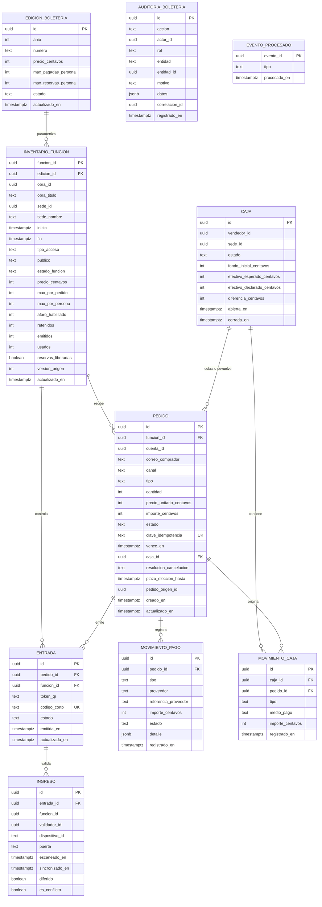
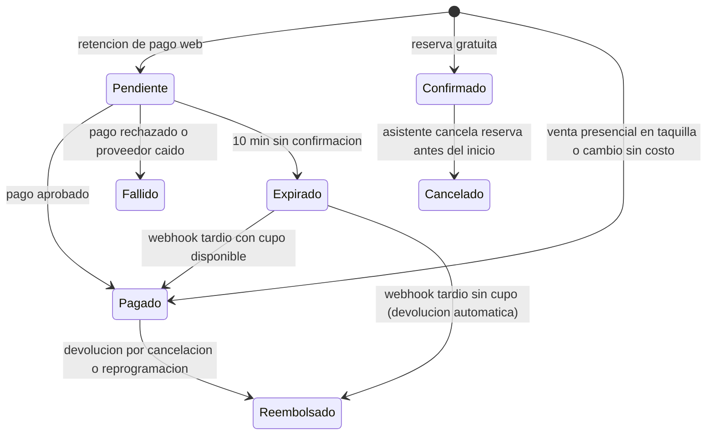
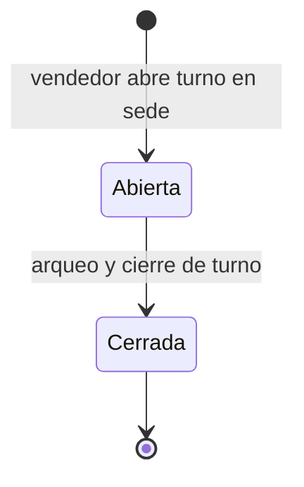

# Data Model: Boletería y control de acceso (002)

Esquema PostgreSQL **`boleteria`**, propiedad exclusiva de este módulo (Constitución III y
[ADR-0001](../../docs/adr/0001-monolito-modular.md)). Ningún otro módulo consulta ni escribe
estas tablas; la comunicación con Programación (001), Operación (004) e Identidad (004) se hace
por contratos y eventos de dominio.

## Entidades y reglas

### `edicion_boleteria`
Proyección local mínima de los parámetros económicos y límites de cada edición (recibidos al
publicarse o configurarse, [FR-001](spec.md#functional-requirements),
[FR-006](spec.md#functional-requirements)).

| Campo | Tipo / Valores | Regla |
|-------|----------------|-------|
| `precio_centavos` | entero ≥ 0 | En centavos de USD; 500 = USD 5,00 en 2026 (Constitución V) |
| `max_pagadas_persona` | entero > 0 | Por defecto 6 (FR-006) |
| `max_reservas_persona` | entero > 0 | Por defecto 4 (FR-006) |
| `estado` | `borrador` \| `publicada` \| `cerrada` | Solo ediciones `publicada` admiten nuevas ventas/reservas |

### `inventario_funcion`
Fuente de verdad única del cupo de cada función con aforo ([ADR-0004](../../docs/adr/0004-control-de-aforo.md)).

| Campo | Tipo / Valores | Regla |
|-------|----------------|-------|
| `tipo_acceso` | `pagada` \| `gratuita_reserva` \| `gratuita_libre` \| `restringida` | `gratuita_libre` no admite compras ni reservas (US3-AS3) |
| `publico` | `familiar` \| `adultos` \| `estudiantes` | `restringida` exige condición `estudiantes` acreditada o vía taquilla (RN-007) |
| `estado_funcion` | `borrador` \| `programada` \| `reprogramada` \| `cancelada` \| `finalizada` | Solo `programada` y `reprogramada` admiten ventas/reservas |
| `aforo_habilitado` | entero ≥ 0 | Si `AforoCambiado` lo reduce por debajo de `emitidos + retenidos`, se bloquea la venta y se emite `AforoExcedido` |
| `retenidos` | entero ≥ 0 | Lugares bloqueados por pedidos `pendiente` durante los 10 minutos de pago |
| `emitidos` | entero ≥ 0 | Entradas activas emitidas (`valida` + `usada`); baja al anular o liberar |
| `usados` | entero ≥ 0 | Ingresos válidos únicos confirmados (US6) |
| `reservas_liberadas` | booleano | Evita liberar dos veces una función gratuita 10 min antes del inicio (FR-013) |
| `version_origen` | entero ≥ 1 | Evita aplicar eventos de Operación fuera de orden |

**Invariante de control de aforo (FR-003, RN-001)**:
- Disponibles = `max(0, aforo_habilitado - emitidos - retenidos)`.
- En toda operación de creación/retención, la actualización condicional verifica en base de datos
  `aforo_habilitado - emitidos - retenidos >= cantidad` antes de sumar `retenidos` o `emitidos`.
- `CHECK (retenidos >= 0 AND emitidos >= 0 AND usados >= 0)`.

### `pedido`
| Campo | Tipo / Valores | Regla |
|-------|----------------|-------|
| `cuenta_id` | uuid o nulo | Obligatorio para canal `web` (FR-016); nulo permitido en `taquilla` (US4-AS5) |
| `canal` | `web` \| `taquilla` \| `cambio` | Origen de la emisión |
| `tipo` | `compra` \| `reserva` | `reserva` tiene `importe_centavos = 0` |
| `precio_unitario_centavos` | entero ≥ 0 | Congelado al crear el pedido (RN-002) |
| `importe_centavos` | entero ≥ 0 | `cantidad * precio_unitario_centavos` (0 en cambio por cancelación, US5-AS3) |
| `estado` | `pendiente` \| `pagado` \| `fallido` \| `expirado` \| `reembolsado` \| `confirmado` \| `cancelado` | Ver diagrama de estados |
| `clave_idempotencia` | text `UNIQUE` | Obligatoria para evitar cobros o emisiones duplicadas (FR-005) |
| `vence_en` | timestamptz o nulo | `creado_en + 10 min` mientras está `pendiente` (FR-004) |
| `resolucion_cancelacion` | `devolucion` \| `cambiado` \| `pendiente_eleccion` \| nulo | Gestión de US5 ante cancelación o reprogramación |
| `plazo_eleccion_hasta` | timestamptz o nulo | `7 días` tras `FuncionCancelada` antes de devolución automática (US5-AS5) |
| `pedido_origen_id` | uuid o nulo | Apunta al pedido original cuando `canal = 'cambio'` (US5-AS3) |

**Índices**: `(funcion_id, estado, vence_en)` para expirar retenciones cada 30 s; `(cuenta_id, funcion_id)` para límite por persona y "Mis entradas".

### `entrada`
| Campo | Tipo / Valores | Regla |
|-------|----------------|-------|
| `token_qr` | text | Formato `v1.<entradaId>.<funcionId>.<emitidaEnEpoch>.<firmaEd25519Base64Url>` (FR-007) |
| `codigo_corto` | text `UNIQUE` | 8 caracteres alfanuméricos sin `0/O/1/I/L`, impreso bajo el QR (US2-AS7) |
| `estado` | `valida` \| `usada` \| `anulada` \| `liberada` | Ver diagrama de estados |

**Índices**: `(funcion_id, estado)` para descarga del paquete del validador y liberación de reservas; `codigo_corto` único.

### `ingreso`
| Campo | Regla |
|-------|-------|
| `entrada_id`, `dispositivo_id`, `escaneado_en` | Índice único `(entrada_id, dispositivo_id, escaneado_en)` para sincronización idempotente (FR-005, FR-008) |
| `diferido` | `true` si se registró sin conexión en la PWA |
| `es_conflicto` | `true` cuando un segundo dispositivo sincroniza una entrada ya validada en otro dispositivo; dispara `ConflictoDeIngreso` (US2-AS6) |

### `movimiento_pago` (inmutable — Constitución V, RNF-004)
Bitácora *append-only* de todas las interacciones monetarias con el proveedor externo. **Nunca se
actualiza ni elimina**; una reversión se registra como un nuevo registro `reembolso`.

| Campo | Valores / Regla |
|-------|-----------------|
| `tipo` | `intencion` \| `cobro` \| `rechazo` \| `reembolso` |
| `proveedor` | `payphone` \| `simulador` |
| `referencia_proveedor` | Identificador externo de transacción; índice único parcial `(proveedor, referencia_proveedor, tipo)` cuando no es nulo |
| `importe_centavos` | Entero > 0 en centavos de USD |
| `estado` | `iniciado` \| `aprobado` \| `rechazado` \| `reembolsado` \| `error` |

### `caja` y `movimiento_caja`
- Índice único parcial en `caja (vendedor_id, sede_id) WHERE estado = 'abierta'` (un turno abierto por vendedor y sede).
- `movimiento_caja` es *append-only* (`tipo`: `venta` \| `egreso_devolucion`; `medio_pago`: `efectivo` \| `tarjeta_datafono`).
- Al cerrar la caja (`cerrada`), `efectivo_esperado_centavos = fondo_inicial_centavos + ventas_efectivo - egresos_efectivo`, `diferencia_centavos = efectivo_declarado_centavos - efectivo_esperado_centavos` (SC-006).

### `auditoria_boleteria` y `evento_procesado`
- `auditoria_boleteria` (inmutable, Constitución IX): registra apertura/cierre de caja, devoluciones, cambios de función, anulaciones masivas y conflictos de ingreso, siempre con `correlacion_id`.
- `evento_procesado`: clave primaria `evento_id` para garantizar consumo idempotente de eventos de Operación (ADR-0003).

---

## Ciclos de vida

### Pedido

### Entrada

```mermaid
stateDiagram-v2
    [*] --> Valida: pedido pagado o reserva confirmada
    Valida --> Usada: primer ingreso validado en puerta
    Valida --> Anulada: cancelacion de funcion, devolucion o reserva cancelada
    Valida --> Liberada: reserva sin validar 10 min antes del inicio
    Usada --> [*]
    Anulada --> [*]
    Liberada --> [*]
```

### Caja (taquilla)

---

## Datos que viven en el navegador

| Dato | Dónde | Uso |
|------|-------|-----|
| Paquetes de función (`paquetes`) | IndexedDB (`fiavl-validador`) | Llave pública Ed25519, metadatos de función, ventana RN-003 y lista de entradas (sin datos personales) para validar ≥ 4 h sin red (RNF-005) |
| Cola de ingresos pendientes (`colaIngresos`) | IndexedDB (`fiavl-validador`) | Escaneos registrados offline para sincronizar por lote al recuperar conexión (US2-AS5) |
| Clave de idempotencia del intento | Memoria / `sessionStorage` de la pestaña de checkout | Evita duplicar pedidos ante doble clic o reconexión (US1-AS4) |

---

## Reglas de negocio como funciones puras de dominio (probadas primero)

| Regla | Función pura en `domain/` | Prueba requerida |
|-------|---------------------------|------------------|
| RN-001 Disponibilidad | `calcularDisponibilidad({ aforoHabilitado, emitidos, retenidos })` | Devuelve `max(0, aforo - emitidos - retenidos)` |
| RN-002 Importe congelado | `calcularImporteCentavos(cantidad, precioCentavos)` | Entero exacto en centavos, sin decimales flotantes |
| RN-003 Ventana de validación | `validarVentanaIngreso(inicio, fin, ahora)` | Acepta solo en `[inicio - 60 min, fin]` |
| RN-004 Ventana de venta web | `ventaEnLineaHabilitada(inicio, ahora, estadoFuncion)` | Rechaza si `ahora > inicio + 30 min` o función no activa |
| RN-005 Validez reprogramada | `esEntradaValidaParaFuncion(entrada, funcion)` | Sigue válida si `funcion.estado === 'reprogramada'` |
| RN-006 Elegibilidad de devolución | `puedeSolicitarDevolucion(pedido, funcion)` | Solo si `funcion` está `cancelada` o `reprogramada` |
| RN-007 Público restringido | `puedeComprarPorCanal(tipoAcceso, canal, estudianteAcreditado)` | Bloquea en web sin acreditación; permite en taquilla |
| US2 Decisión de escaneo | `evaluarEscaneoEntrada({ entrada, firmaValida, funcionAbierta, ahora, dispositivoId })` | Devuelve `verde`, `ambar` (< 60 s mismo dispositivo) o `rojo` con motivo exacto |
| US4 Arqueo de caja | `calcularArqueoCaja(fondoInicial, movimientos, efectivoDeclarado)` | Calcula esperado y diferencia en centavos |
| FR-007 Token Ed25519 y código | `construirCargaQr()`, `formatearCodigoCorto()` | Firma verificable con Web Crypto y código de 8 caracteres válidos |
