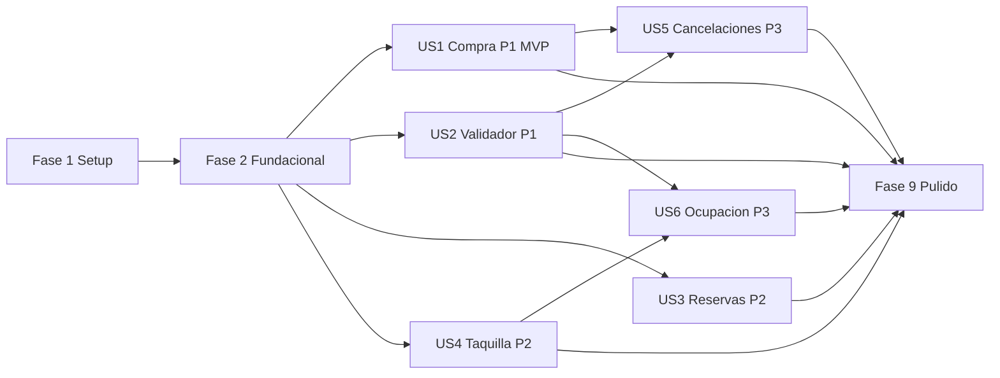

# Tasks: Boletería y control de acceso

**Input**: Documentos de diseño en `/specs/002-boleteria-entradas/`

**Prerequisites**: [plan.md](plan.md), [spec.md](spec.md), [research.md](research.md),
[data-model.md](data-model.md), [contracts/](contracts/), [quickstart.md](quickstart.md)

**Tests**: **Obligatorias** por la Constitución (Principio IV): cada escenario `USn-ASm` tiene al
menos una prueba automatizada con su identificador en el nombre o descripción, y las reglas
críticas (`RN-001`–`RN-007`, control de aforo, firma Ed25519, arqueo y evaluación de ingreso) se
desarrollan **probando primero** (rojo → verde → refactor).

**Organization**: Tareas agrupadas por historia de usuario (`US1`–`US6`) en orden de prioridad
(`P1` → `P2` → `P3`) para poder implementarse y verificarse de forma independiente.

## Format: `[ID] [P?] [Story] Description`

- **[P]**: Ejecutable en paralelo (archivos distintos, sin dependencias pendientes)
- **[Story]**: Historia de usuario a la que pertenece (`US1`–`US6`, solo en fases de historia)
- Rutas exactas según [plan.md](plan.md#project-structure)

## Path Conventions

- API y dominio: `apps/api/src/modules/boleteria/` · integración: `apps/api/test/boleteria/`
- Worker: `apps/api/src/worker.module.ts` y `apps/api/src/modules/boleteria/infrastructure/consumidores.pgboss.ts`
- Web pública, panel y PWA: `apps/web/src/app/(publico)/`, `apps/web/src/app/(panel)/`, `apps/web/src/app/validador/` · librería: `apps/web/src/lib/boleteria/` · E2E: `apps/web/e2e/`
- Contratos compartidos: `packages/contracts/src/` · esquema de datos: `prisma/schema/boleteria.prisma`

---

## Phase 1: Setup (preparación del módulo sobre el monorepo existente)

**Purpose**: Configurar dependencias, esquema Prisma, generación de tipos OpenAPI y variables de entorno de Boletería.

- [ ] T001 Instalar `qrcode` y `@types/qrcode` en `apps/api/package.json` y `apps/web/package.json` (justificada en [research R11](research.md#r11-pruebas-verificación-de-sc-001sc-006-y-justificación-de-dependencias)) y verificar `pnpm lint && pnpm typecheck`
- [ ] T002 [P] Añadir el esquema `"boleteria"` en `prisma/schema/schema.prisma` y configurar las variables `BOLETERIA_PAGOS_PROVEEDOR`, `BOLETERIA_QR_PRIVADA_PEM`, `PAYPHONE_TOKEN` y `PAYPHONE_STORE_ID` en `.env.example`
- [ ] T003 [P] Actualizar el script `gen` en `packages/contracts/package.json` para generar `packages/contracts/src/api/boleteria.ts` desde [api-boleteria.openapi.yaml](contracts/api-boleteria.openapi.yaml) mediante `openapi-typescript`
- [ ] T004 [P] Crear la estructura de carpetas hexagonales (`domain/`, `application/`, `infrastructure/`, `interface/`) en `apps/api/src/modules/boleteria/` respetando las reglas de fronteras ESLint de la [vista de desarrollo](../../docs/arquitectura/02-vista-desarrollo.md)

**Checkpoint**: `pnpm install && pnpm lint && pnpm typecheck` en verde con el esqueleto del módulo `boleteria`.

---

## Phase 2: Foundational (prerrequisitos bloqueantes de todas las historias)

**Purpose**: Esquema de base de datos, contratos de eventos, reglas puras base de aforo y firma Ed25519, puertos, repositorio atómico y consumidores/publicadores `pg-boss`.

**⚠️ CRITICAL**: Ninguna historia de usuario (`US1`–`US6`) comienza hasta completar esta fase.

### Pruebas primero (deben fallar antes de implementar)

- [ ] T005 [P] Pruebas de contrato Zod con ejemplos válidos e inválidos para `AforoCambiado`, `DisponibilidadCambiada`, `EntradasEmitidas`, `IngresoRegistrado`, `PedidoReembolsado`, `ConflictoDeIngreso` y `AforoExcedido` en `packages/contracts/src/eventos/eventos.test.ts` según [eventos-boleteria.md](contracts/eventos-boleteria.md)
- [ ] T006 [P] Pruebas unitarias de `calcularDisponibilidad` (`RN-001`), `calcularImporteCentavos` (`RN-002`, centavos enteros), `puedeComprarPorCanal` (`RN-007`) y validación de límites por pedido y por persona (`FR-006`) en `apps/api/src/modules/boleteria/domain/reglas-aforo.test.ts`
- [ ] T007 [P] Pruebas unitarias de generación/verificación de tokens **Ed25519** (`construirCargaQr`, `firmarTokenQr`, `verificarTokenQr`) y generación de códigos cortos de 8 caracteres sin ambigüedad (`FR-007`) en `apps/api/src/modules/boleteria/domain/firma-qr.test.ts`
- [ ] T008 [P] Prueba de integración del consumidor idempotente de eventos de Operación en `apps/api/test/boleteria/eventos-operacion.int.test.ts`: evento repetido en `boleteria.evento_procesado` no duplica y versión antigua se ignora (`ProgramacionPublicada`, `FuncionProgramada`, `FuncionActualizada`)

### Implementación

- [ ] T009 Definir el esquema `boleteria` completo (`EdicionBoleteria`, `InventarioFuncion`, `Pedido`, `Entrada`, `Ingreso`, `MovimientoPago`, `Caja`, `MovimientoCaja`, `AuditoriaBoleteria`, `EventoProcesado` y enums) en `prisma/schema/boleteria.prisma` según [data-model.md](data-model.md)
- [ ] T010 Crear la migración SQL en `prisma/schema/migrations/` para el esquema `boleteria` con restricciones `CHECK (retenidos >= 0 AND emitidos >= 0 AND usados >= 0)`, índices parciales únicos (`movimiento_pago` por referencia externa y `caja` abierta única por vendedor/sede) e índices de consulta
- [ ] T011 [P] Implementar los esquemas Zod de `AforoCambiado` y parámetros opcionales retrocompatibles de edición (`precioCentavos?`, `maxPagadasPersona?`, `maxReservasPersona?`) en `packages/contracts/src/eventos/operacion.ts`, los eventos publicados en `packages/contracts/src/eventos/boleteria.ts`, exportarlos en `packages/contracts/src/eventos/index.ts` y añadir ejemplos en `packages/contracts/src/eventos/ejemplos.ts` (hace pasar T005)
- [ ] T012 [P] Ejecutar `pnpm contracts:gen` y exportar `ApiBoleteria` en `packages/contracts/src/api/index.ts` y `packages/contracts/src/index.ts`, además de crear el cliente HTTP tipado base en `apps/web/src/lib/boleteria/api-boleteria.ts`
- [ ] T013 [P] Implementar tipos/enums de dominio en `apps/api/src/modules/boleteria/domain/tipos.ts`, funciones puras `reglas-aforo.ts` (hace pasar T006) y `firma-qr.ts` con `node:crypto` Ed25519 (hace pasar T007)
- [ ] T014 Definir los puertos `RepositorioBoleteria`, `ProveedorPagos`, `PublicadorEventosBoleteria` y `AutorizacionBoleteriaPort` en `apps/api/src/modules/boleteria/application/puertos.ts`
- [ ] T015 Implementar `PrismaBoleteriaRepository` en `apps/api/src/modules/boleteria/infrastructure/prisma-boleteria.repository.ts` incluyendo la sentencia `UPDATE` atómica condicional de [ADR-0004](../../docs/adr/0004-control-de-aforo.md) y el registro en `auditoria_boleteria`
- [ ] T016 [P] Implementar `PublicadorPgBossBoleteria` en `apps/api/src/modules/boleteria/infrastructure/publicador.pgboss.ts` validando cada evento con `Esquema.parse()` antes de encolar, propagando `correlacionId` (Constitución IX) y agrupando `DisponibilidadCambiada` con `singletonKey: funcionId` (5 s) salvo en eventos terminales
- [ ] T017 Implementar `AplicarEventoOperacion` en `apps/api/src/modules/boleteria/application/eventos/aplicar-evento-operacion.ts` (aplicando valores por defecto `500` centavos, `6` pagadas, `4` reservas si `ProgramacionPublicada` omite parámetros opcionales de edición) y los consumidores `boleteria.*` en `apps/api/src/modules/boleteria/infrastructure/consumidores.pgboss.ts` (hace pasar T008)
- [ ] T018 [P] Implementar `AutorizacionDevAdapter` (activo solo en `development`/`test`, fail-closed en otro entorno) en `apps/api/src/modules/boleteria/infrastructure/autorizacion-dev.adapter.ts`, las guardas `BoleteriaGuard` (sesión verificada, rol y alcance de sede, condición estudiante) en `apps/api/src/modules/boleteria/interface/boleteria.guard.ts`, y registrar `BoleteriaModule` en `apps/api/src/modules/boleteria/boleteria.module.ts`, `apps/api/src/app.module.ts` y `apps/api/src/worker.module.ts`
- [ ] T019 [P] Extender la semilla en `prisma/seed/edicion-2026.ts` (y `prisma/seed/index.ts`) para poblar `inventario_funcion` y `edicion_boleteria` (USD 5,00), y ampliar `scripts/emitir-evento.ts` para emitir eventos hacia `boleteria.*` (`funcion-cancelada`, `funcion-reprogramada`, `aforo-cambiado`)

**Checkpoint**: Base de datos migrada, semilla cargada, contratos Zod validados y T005–T008 en verde.

---

## Phase 3: User Story 1 - Comprar entradas para una función pagada (Priority: P1) 🎯 MVP

**Goal**: El asistente con cuenta verificada selecciona entradas pagadas, retiene cupo durante 10 min, paga en pasarela externa con idempotencia total y recibe sus entradas con QR en correo y en `/mis-entradas`.

**Cubre**: FR-001, FR-003, FR-004, FR-005, FR-006, FR-007, FR-009, FR-010, FR-014, FR-016, RN-001, RN-002, RN-004, RN-007, RNF-001, RNF-002, RNF-004, SC-001, SC-002, SC-004, SC-005

**Independent Test**: Escenarios 1–4 de [quickstart.md](quickstart.md#escenarios-de-validación-end-to-end): en una función de aforo 10, comprar 2 entradas con el simulador de pagos y verificar 2 entradas con QR único, importe USD 10,00 y 8 lugares disponibles; ejecutar la prueba de 500 compras simultáneas sobre 100 lugares.

### Tests for User Story 1 ⚠️

- [ ] T020 [P] [US1] Prueba unitaria de `ventaEnLineaHabilitada` (`RN-004`, cierre 30 min después del inicio) y manejo de parámetros/estados de compra en `apps/api/src/modules/boleteria/domain/reglas-acceso.test.ts`
- [ ] T021 [P] [US1] Pruebas de integración en Testcontainers para `US1-AS1`, `US1-AS2`, `US1-AS3`, `US1-AS4`, `US1-AS5`, `US1-AS6` y `SC-005` en `apps/api/test/boleteria/compras.int.test.ts`: compra aprobada (`US1-AS1`), pago rechazado libera cupo (`US1-AS2`), pedido mayor al cupo informa restantes sin iniciar pago (`US1-AS3`), `Idempotency-Key` repetida y webhook duplicado no cobran ni emiten doble (`US1-AS4`), expiración a 10 min libera retención (`US1-AS5`), webhook tardío sobre pedido expirado emite si hay cupo o reembolsa automáticamente si no hay cupo (`US1-AS6`), y caída del proveedor devuelve `503` liberando lugares
- [ ] T022 [P] [US1] Prueba de concurrencia real **SC-001 / RNF-001** en `apps/api/test/boleteria/concurrencia.int.test.ts`: lanzar **500 solicitudes simultáneas** sobre una función con **100 lugares** y verificar exactamente 100 entradas emitidas, 0 sobreventa y 0 cobros duplicados
- [ ] T023 [P] [US1] Prueba E2E de compra en línea, retorno de pago, visualización de QR en `/mis-entradas` en < 1 min y encolado inmediato de `EntradasEmitidas` para envío por correo (`US1-AS1`, `US1-AS2`, `US1-AS3`, `US1-AS4`, `SC-002`, `SC-004` en alcance de Boletería) con auditoría `@axe-core/playwright` en `apps/web/e2e/boleteria-compras.spec.ts`

### Implementation for User Story 1

- [ ] T024 [P] [US1] Implementar `ventaEnLineaHabilitada` (`RN-004`) y reglas de acceso web en `apps/api/src/modules/boleteria/domain/reglas-acceso.ts` (hace pasar T020)
- [ ] T025 [P] [US1] Implementar la capa anticorrupción de pagos (`ADR-0007`): `SimuladorPagosAdapter` (determinista + modo falla simulada) en `apps/api/src/modules/boleteria/infrastructure/pagos-simulador.adapter.ts` y `PayPhonePagosAdapter` en `apps/api/src/modules/boleteria/infrastructure/pagos-payphone.adapter.ts`
- [ ] T026 [US1] Implementar los casos de uso `ConsultarDisponibilidadFuncion` y `CrearPedidoPagado` (retención atómica 10 min, `Idempotency-Key`, límites `FR-006`, acreditación `RN-007`) en `apps/api/src/modules/boleteria/application/compras/crear-pedido-pagado.ts` y `apps/api/src/modules/boleteria/application/consultas/disponibilidad.ts`
- [ ] T027 [US1] Implementar `ProcesarWebhookPago` (idempotente por `referencia_proveedor`, registro inmutable `movimiento_pago`, manejo de confirmación tardía `US1-AS6` y emisión de `EntradasEmitidas`/`PedidoReembolsado`), `ExpirarRetenciones` (cada 30 s), `ConciliarPagosPendientes` (cada 2 min) y `ReenviarEntradasCorreo` en `apps/api/src/modules/boleteria/application/compras/`
- [ ] T028 [US1] Implementar DTOs Zod en `apps/api/src/modules/boleteria/interface/esquemas.ts` y los controladores `DisponibilidadController`, `PedidosController` y `PagosWebhookController` (`GET /funciones/{funcionId}/disponibilidad`, `POST /pedidos`, `GET /mis-entradas`, `GET /pedidos/{pedidoId}`, `POST /pedidos/{pedidoId}/reenviar-correo`, `POST /pagos/webhook`) en `apps/api/src/modules/boleteria/interface/` (hacen pasar T021 y T022)
- [ ] T029 [P] [US1] Crear el componente reutilizable `BoletoQr` (renderizado SVG local con `qrcode` + código corto legible) en `apps/web/src/components/boleteria/boleto-qr.tsx` y las páginas `/entradas/[funcionId]`, `/pedidos/[id]/retorno` y `/mis-entradas` en `apps/web/src/app/(publico)/` (hace pasar T023)

**Checkpoint**: US1 funciona de punta a punta como MVP demostrable (compra, idempotencia, concurrencia 500→100, QR y "Mis entradas").

---

## Phase 4: User Story 2 - Validar el ingreso en la sala (Priority: P1)

**Goal**: El personal validador en puerta abre la función, escanea QR (o escribe código corto) con respuesta pantalla completa verde/ámbar/rojo en < 2 s, opera ≥ 4 horas sin internet y sincroniza conflictos al reconectar.

**Cubre**: FR-005, FR-007, FR-008, RN-003, RNF-003, RNF-005, SC-003

**Independent Test**: Escenarios 5 y 6 de [quickstart.md](quickstart.md#escenarios-de-validación-end-to-end): descargar paquete de función, activar modo `offline`, validar entrada válida (verde), reescanear en < 1 min mismo dispositivo (ámbar), validar usada en otro dispositivo o de otra función (rojo), validar con código corto y sincronizar dos dispositivos conflictivos verificando `ConflictoDeIngreso`.

### Tests for User Story 2 ⚠️

- [ ] T030 [P] [US2] Pruebas unitarias de `validarVentanaIngreso` (`RN-003`: desde 60 min antes hasta fin) y `evaluarEscaneoEntrada` (`verde`, `ambar` < 60 s mismo dispositivo, `rojo` con motivo exacto para usada/otra función/anulada/liberada/firma inválida) en `apps/api/src/modules/boleteria/domain/evaluador-ingreso.test.ts`
- [ ] T031 [P] [US2] Pruebas unitarias del motor offline del navegador (almacén IndexedDB simulado, verificación Ed25519 con Web Crypto, regla ámbar < 60 s, búsqueda por código corto y cálculo de `desfaseMs`) en `apps/web/src/lib/boleteria/validador-offline.test.ts`
- [ ] T032 [P] [US2] Pruebas de integración en Testcontainers para `US2-AS1`, `US2-AS2`, `US2-AS3`, `US2-AS4`, `US2-AS5`, `US2-AS6` y `US2-AS7` en `apps/api/test/boleteria/validador.int.test.ts`: descarga de paquete sin datos personales, validación en línea (`US2-AS1`), rechazo de usada con hora y puerta (`US2-AS2`), otra función con datos correctos (`US2-AS3`), entrada anulada (`US2-AS4`), ingreso por código corto (`US2-AS7`), sincronización idempotente de lecturas diferidas (`US2-AS5`, `FR-005`), compensación de reloj manipulado y conflicto entre dos dispositivos offline emitiendo `ConflictoDeIngreso` (`US2-AS6`)
- [ ] T033 [P] [US2] Prueba E2E de validación en puerta con simulación de corte de red (`context.setOffline(true)`), verificación semafórica accesible verde/ámbar/rojo, escaneo por código corto (`US2-AS1`, `US2-AS2`, `US2-AS5`, `US2-AS7`) y sincronización al reconectar en `apps/web/e2e/boleteria-validador.spec.ts`

### Implementation for User Story 2

- [ ] T034 [P] [US2] Implementar `validarVentanaIngreso` (`RN-003`) y `evaluarEscaneoEntrada` en `apps/api/src/modules/boleteria/domain/evaluador-ingreso.ts` (hace pasar T030)
- [ ] T035 [US2] Implementar los casos de uso `DescargarPaqueteValidador`, `ValidarEntradaEnLinea` y `SincronizarIngresosOffline` (publicando `IngresoRegistrado` y `ConflictoDeIngreso`, con compensación de `desfaseMs`) en `apps/api/src/modules/boleteria/application/validador/` y los endpoints en `apps/api/src/modules/boleteria/interface/validador.controller.ts` (hace pasar T032)
- [ ] T036 [P] [US2] Implementar `validador-offline.ts` (IndexedDB `fiavl-validador`, `crypto.subtle.verify('Ed25519', ...)`, cola local de sincronización) en `apps/web/src/lib/boleteria/validador-offline.ts` (hace pasar T031) y el Service Worker en `apps/web/src/app/validador/sw.js/route.ts` (RNF-005 ≥ 4 h offline)
- [ ] T037 [US2] Crear las páginas PWA `/validador` y `/validador/[funcionId]` en `apps/web/src/app/validador/` con lector de cámara (`BarcodeDetector`), formulario accesible por teclado para código corto, respuesta pantalla completa verde/ámbar/rojo con texto/icono/`aria-live="assertive"` y botón de sincronización (hace pasar T033)

**Checkpoint**: US1 y US2 (ambas historias P1) completadas y probadas en línea y sin conexión.

---

## Phase 5: User Story 3 - Reservar en función gratuita con aforo (Priority: P2)

**Goal**: El asistente reserva lugares sin costo en funciones gratuitas con aforo (respetando límite de 4 por persona y restricción de estudiantes), puede cancelar antes del inicio y las reservas no validadas se liberan automáticamente 10 min antes del inicio.

**Cubre**: FR-002, FR-003, FR-005, FR-006, FR-013, FR-016, RN-001, RN-007

**Independent Test**: Escenarios 7 y 8 de [quickstart.md](quickstart.md#escenarios-de-validación-end-to-end): reservar 2 lugares en "Cometa" sin pasarela de pago, verificar límite de 4 por persona, verificar rechazo en función `gratuita_libre`, cancelar reserva y comprobar liberación automática a `inicio - 10 min`.

### Tests for User Story 3 ⚠️

- [ ] T038 [P] [US3] Pruebas de integración en Testcontainers para `US3-AS1`, `US3-AS2`, `US3-AS3`, `US3-AS4`, `US3-AS5` y `FR-013` en `apps/api/test/boleteria/reservas.int.test.ts`: reserva sin costo (`US3-AS1`), rechazo en función `gratuita_libre` (`US3-AS3`), límite acumulado de 4 por persona (`US3-AS4`), restricción de estudiantes en `restringida` (`RN-007`), cancelación antes del inicio (`US3-AS5`) y job de liberación a `inicio - 10 min` pasando entradas no usadas a `liberada` (`US3-AS2`)
- [ ] T039 [P] [US3] Prueba E2E de flujo de reserva gratuita, aviso "Entrada libre" en funciones de plaza, límite por persona y cancelación en `/mis-entradas` en `apps/web/e2e/boleteria-reservas.spec.ts`

### Implementation for User Story 3

- [ ] T040 [US3] Implementar `CrearReservaGratuita`, `CancelarReserva` y el trabajo programado cada 60 s `LiberarReservasNoValidadas` (`FR-013`) en `apps/api/src/modules/boleteria/application/reservas/` y registrarlo en `consumidores.pgboss.ts`
- [ ] T041 [US3] Exponer `POST /reservas` y `POST /pedidos/{pedidoId}/cancelar-reserva` en `apps/api/src/modules/boleteria/interface/pedidos.controller.ts` (hace pasar T038)
- [ ] T042 [P] [US3] Adaptar `/entradas/[funcionId]/page.tsx` (flujo sin pago para `gratuita_reserva`, bloqueo para `restringida` sin acreditación e informativo "Entrada libre" para `gratuita_libre`) y añadir acción "Cancelar reserva" en `apps/web/src/app/(publico)/mis-entradas/page.tsx` (hace pasar T039)

**Checkpoint**: US3 independiente y verificada junto con liberación automática a T-10 min.

---

## Phase 6: User Story 4 - Venta en taquilla física (Priority: P2)

**Goal**: El personal de taquilla autorizado en su sede abre caja, vende entradas presenciales (efectivo o datáfono) compartiendo el inventario atómico con la web y sin exigir cuenta al comprador, imprime el QR y realiza el arqueo de cierre con diferencia 0.

**Cubre**: FR-003, FR-005, FR-007, FR-011, FR-016, RN-001, RN-004, RN-007, SC-006

**Independent Test**: Escenario 9 de [quickstart.md](quickstart.md#escenarios-de-validación-end-to-end): abrir caja en sede, competir taquilla vs. web por el último lugar (solo 1 concreta), vender sin correo en efectivo y datáfono, intentar vender con caja cerrada (rechazado) y cerrar caja verificando arqueo cuadrado.

### Tests for User Story 4 ⚠️

- [ ] T043 [P] [US4] Pruebas unitarias de `calcularArqueoCaja` (fondo inicial + ventas efectivo − egresos efectivo, ignorando datáfono en efectivo esperado, cálculo de diferencia en centavos, `SC-006`) en `apps/api/src/modules/boleteria/domain/arqueo-caja.test.ts`
- [ ] T044 [P] [US4] Pruebas de integración en Testcontainers para `US4-AS1`, `US4-AS2`, `US4-AS3`, `US4-AS4`, `US4-AS5` y `SC-006` en `apps/api/test/boleteria/taquilla.int.test.ts`: carrera simultánea taquilla vs. web por el último cupo (`US4-AS1`), registro de venta en efectivo/datáfono en caja abierta (`US4-AS2`), cierre de turno con arqueo exacto (`US4-AS3`), rechazo en caja cerrada (`US4-AS4`), venta sin cuenta ni correo (`US4-AS5`) y bloqueo por alcance de sede (`Constitución VI`)
- [ ] T045 [P] [US4] Prueba E2E de apertura de caja, venta presencial con vista imprimible sin cuenta y cierre con arqueo en `/taquilla` (`US4-AS2`, `US4-AS3`, `US4-AS5`) en `apps/web/e2e/boleteria-taquilla.spec.ts`

### Implementation for User Story 4

- [ ] T046 [P] [US4] Implementar `calcularArqueoCaja` en `apps/api/src/modules/boleteria/domain/arqueo-caja.ts` (hace pasar T043)
- [ ] T047 [US4] Implementar los casos de uso `AbrirCaja`, `ObtenerCajaActual`, `VenderEnTaquilla` (permitiendo venta presencial tras `inicio + 30 min` según caso borde de `RN-004`) y `CerrarCaja` en `apps/api/src/modules/boleteria/application/taquilla/`
- [ ] T048 [US4] Implementar `TaquillaController` (`POST /taquilla/cajas`, `GET /taquilla/cajas/actual`, `POST /taquilla/cajas/{cajaId}/cerrar`, `POST /taquilla/ventas`) en `apps/api/src/modules/boleteria/interface/taquilla.controller.ts` protegido por rol `taquilla` y alcance `sedeId` (hace pasar T044)
- [ ] T049 [P] [US4] Crear la página `/taquilla` en `apps/web/src/app/(panel)/taquilla/page.tsx` con apertura de caja, selector de función de la sede, venta rápida efectivo/datáfono, boleto imprimible (`@media print`) y formulario de cierre/arqueo (hace pasar T045)

**Checkpoint**: Web y taquilla comparten inventario atómicamente y los turnos de caja cuadran al 100 %.

---

## Phase 7: User Story 5 - Cancelación de función, devoluciones y cambios (Priority: P3)

**Goal**: Ante `FuncionCancelada`, se anulan las entradas, los compradores eligen entre devolución (en línea o en efectivo en taquilla) o cambio a otra función de la misma obra, y las elecciones pendientes vencen a los 7 días con devolución automática. También gestiona `FuncionReprogramada` y reducción de `AforoCambiado`.

**Cubre**: FR-012, FR-014, RN-005, RN-006

**Independent Test**: Escenarios 10 y 11 de [quickstart.md](quickstart.md#escenarios-de-validación-end-to-end): emitir `FuncionCancelada` sobre una función con pedidos pagados en línea y taquilla efectivo, verificar anulación, cambio sin nuevo cobro, devolución en línea, devolución en efectivo en taquilla y devolución automática tras 7 días.

### Tests for User Story 5 ⚠️

- [ ] T050 [P] [US5] Pruebas unitarias de `esEntradaValidaParaFuncion` (`RN-005` reprogramada) y `puedeSolicitarDevolucion` (`RN-006` solo cancelada o reprogramada) en `apps/api/src/modules/boleteria/domain/reglas-acceso.test.ts`
- [ ] T051 [P] [US5] Pruebas de integración en Testcontainers para `US5-AS1`, `US5-AS2`, `US5-AS3`, `US5-AS4`, `US5-AS5` y casos borde en `apps/api/test/boleteria/cancelaciones.int.test.ts`: `FuncionCancelada` anula entradas y habilita plazo 7 días (`US5-AS1`), elección de devolución en línea vía proveedor y `PedidoReembolsado` (`US5-AS2`), cambio sin nuevo cobro a otra función de la misma obra (`US5-AS3`), devolución en efectivo en taquilla (`US5-AS4`), job automático tras 7 días (`US5-AS5`), `FuncionReprogramada` mantiene entradas válidas y `AforoCambiado` por debajo de emitidas bloquea ventas y emite `AforoExcedido`
- [ ] T052 [P] [US5] Prueba E2E de cancelación, elección de devolución o cambio en `/mis-entradas` y devolución en efectivo en `/taquilla` (`US5-AS2`, `US5-AS3`, `US5-AS4`) en `apps/web/e2e/boleteria-cancelaciones.spec.ts`

### Implementation for User Story 5

- [ ] T053 [US5] Implementar el manejo completo de `FuncionCancelada`, `FuncionReprogramada` (`RN-005`) y `AforoCambiado` (emitiendo `AforoExcedido` si hay exceso sin anular entradas) en `apps/api/src/modules/boleteria/application/cancelaciones/gestionar-cambios-funcion.ts` e integrarlo en `AplicarEventoOperacion`
- [ ] T054 [US5] Implementar los casos de uso `ElegirResolucionCancelacion` (devolución web / cambio sin costo a otra función de la misma obra), `DevolverEnTaquilla` (egreso efectivo en `movimiento_caja`, `US5-AS4`) y el trabajo programado `ProcesarDevolucionesVencidas` (7 días, `US5-AS5`) en `apps/api/src/modules/boleteria/application/cancelaciones/` y `application/taquilla/`
- [ ] T055 [US5] Exponer `POST /pedidos/{pedidoId}/eleccion-cancelacion` en `pedidos.controller.ts` y `POST /taquilla/devoluciones` en `taquilla.controller.ts` (hace pasar T051)
- [ ] T056 [P] [US5] Añadir el selector de devolución/cambio de función en `apps/web/src/app/(publico)/mis-entradas/page.tsx` y el panel de devolución en efectivo en `apps/web/src/app/(panel)/taquilla/page.tsx` (hace pasar T052)

**Checkpoint**: Todas las cancelaciones, reprogramaciones, reducciones de aforo, devoluciones y cambios funcionan de forma autónoma.

---

## Phase 8: User Story 6 - Ocupación en vivo para la sala (Priority: P3)

**Goal**: El jefe de sala (y personal de taquilla/validador) consulta en tiempo real cuántas entradas se emitieron, cuántas personas ingresaron, cuántas faltan por entrar y cuántos lugares quedan disponibles para puerta.

**Cubre**: FR-015, US6-AS1

**Independent Test**: Escenario 12 de [quickstart.md](quickstart.md#escenarios-de-validación-end-to-end): emitir 200 entradas, validar 150 y comprobar en `/sala/{funcionId}` emitidas 200, ingresos 150, pendientes 50 y lugares libres correctos.

### Tests for User Story 6 ⚠️

- [ ] T057 [P] [US6] Prueba de integración `US6-AS1` para `GET /funciones/{funcionId}/ocupacion` (autorización por rol y conteos exactos) en `apps/api/test/boleteria/ocupacion.int.test.ts`
- [ ] T058 [P] [US6] Prueba E2E de consulta en `/sala/{funcionId}` reflejando ingresos tras validar entradas en `apps/web/e2e/boleteria-ocupacion.spec.ts`

### Implementation for User Story 6

- [ ] T059 [US6] Implementar `ConsultarOcupacionEnVivo` en `apps/api/src/modules/boleteria/application/consultas/ocupacion.ts` y `GET /funciones/{funcionId}/ocupacion` en `apps/api/src/modules/boleteria/interface/disponibilidad.controller.ts` (hace pasar T057)
- [ ] T060 [P] [US6] Crear la página `/sala/[funcionId]` en `apps/web/src/app/(panel)/sala/[funcionId]/page.tsx` con actualización periódica y desglose accesible de emitidas, ingresos, pendientes y libres (hace pasar T058)

**Checkpoint**: Las 6 historias de usuario (`US1`–`US6`) completadas y verificadas de forma independiente.

---

## Phase 9: Polish & Cross-Cutting Concerns

**Purpose**: Observabilidad, accesibilidad WCAG 2.1 AA, pruebas de carga, endurecimiento de seguridad y verificación final para el PR.

- [ ] T061 [P] Añadir métricas Prometheus de Boletería (compras iniciadas/aprobadas/expiradas, validaciones por semáforo, conflictos offline, duración de operaciones) en `apps/api/src/modules/boleteria/infrastructure/metricas-boleteria.ts` (Constitución IX)
- [ ] T062 [P] Auditoría E2E de accesibilidad WCAG 2.1 AA (`@axe-core/playwright`) y diseño responsivo a **320 px** con navegación por teclado en `/entradas/{id}`, `/mis-entradas`, `/taquilla`, `/sala/{id}` y `/validador` en `apps/web/e2e/boleteria-accesibilidad.spec.ts` (puerta Q7, Constitución VII)
- [ ] T063 [P] Escribir y validar la prueba de carga k6 para ráfaga de apertura de compra (`RNF-002` p95 < 2 s) y validación en puerta (`RNF-003` p95 < 2 s) en `tests/carga/boleteria.js`
- [ ] T064 [P] Pruebas de seguridad y autorización en `apps/api/test/boleteria/seguridad.int.test.ts` (acceso de titularidad en `/pedidos/{id}`, alcance por sede en taquilla/validador, rechazo de webhooks sin firma válida, guarda temporal cerrada fuera de `development`/`test` y sin exposición de secretos/llave privada) como insumo para `/security-review` (puerta Q8)
- [ ] T065 Ejecutar todos los escenarios de [quickstart.md](quickstart.md), verificar cobertura ≥ 80 % en `apps/api/src/modules/boleteria/domain/` (puerta Q2), ejecutar `pnpm lint && pnpm typecheck && pnpm test` y corregir cualquier fallo
- [ ] T066 [P] Revisar que la implementación refleje los escenarios `E2`, `E3` y `E4` en [05-vista-escenarios.md](../../docs/arquitectura/05-vista-escenarios.md) y preparar el registro de actualización de `ADR-0007` (si procede, en PR aparte según Constitución §6)

---

## Dependencies & Execution Order

### Phase Dependencies



- **Fase 1 (Setup)**: sin dependencias, inicia de inmediato.
- **Fase 2 (Fundacional)**: depende de Setup y **bloquea** todas las historias `US1`–`US6`.
- **US1 (P1 🎯 MVP)**, **US2 (P1)**, **US3 (P2)** y **US4 (P2)**: tras completar la Fase 2, pueden desarrollarse en paralelo porque comparten las mismas tablas base y puertos de Fase 2.
- **US5 (P3)**: depende de US1 (pagos/reembolsos en línea) y US4 (devoluciones en efectivo en taquilla), y amplía `AplicarEventoOperacion` de Fase 2.
- **US6 (P3)**: depende del flujo de emisión (US1/US3/US4) y validación de ingresos (US2) para reflejar cifras en vivo.
- **Fase 9 (Pulido)**: al terminar las historias deseadas.

### Within Each User Story

- Pruebas primero (deben fallar antes de implementar, Constitución IV) → reglas de dominio puras → casos de uso y adaptadores → controladores HTTP → páginas web y E2E.
- Cada historia termina con su *checkpoint* de pruebas en verde antes de pasar a la siguiente prioridad o entrega.

### Dependencias externas

| Tarea | Depende de | Mitigación mientras no exista 004 / 003 |
|-------|-----------|----------------------------------------|
| T018 / T028 / T048 | `AutorizacionPort`, cuentas verificadas y roles por sede de Identidad (004) | `AutorizacionDevAdapter` (`NODE_ENV === 'development' \| 'test'`), falla cerrada `401`/`403` en producción |
| T017 / T053 | Publicación real de eventos desde Operación (004) | Semilla 2026 + script `pnpm events:emit` (T019) |
| T027 | Envío real de correos de `EntradasEmitidas` y `PedidoReembolsado` por Identidad (004) | Boletería encola los eventos validados con Zod en `pg-boss`; al integrarse 004 se consumen sin cambios |

---

## Parallel Example: User Story 1 (P1)

```bash
# 1. Lanzar todas las pruebas iniciales de US1 en paralelo (archivos distintos):
T020 reglas-acceso.test.ts · T021 compras.int.test.ts · T022 concurrencia.int.test.ts · T023 boleteria-compras.spec.ts

# 2. En paralelo mientras se completan los casos de uso:
T024 reglas-acceso.ts · T025 adaptadores de pago · T029 componente boleto-qr.tsx y páginas
```

## Parallel Example: Después de la Fase 2

```bash
# Pueden avanzar en paralelo historias sin bloqueo directo:
US1 (T020–T029) · US2 (T030–T037) · US3 (T038–T042) · US4 (T043–T049)
```

---

## Implementation Strategy

### MVP First (User Story 1 + User Story 2 — P1)

1. Completar **Fase 1 (Setup)** y **Fase 2 (Fundacional)**.
2. Completar **Fase 3 (US1 — Compra en línea sin sobreventa)** → **STOP y validar** pruebas `SC-001` (500 compras / 100 lugares) y `SC-005`.
3. Completar **Fase 4 (US2 — Validador PWA offline/online)** → **STOP y validar** escenario sin internet y resolución de conflictos.
4. Con US1 + US2 en verde ya queda demostrado el núcleo crítico de Boletería (`E2` y `E3` de la vista +1).

### Incremental Delivery

| Entrega | Fases / Historias | Valor entregado |
|---------|-------------------|-----------------|
| 1 (Base) | Fases 1–2 | Esquema `boleteria`, contratos Zod/OpenAPI, firma Ed25519, control de aforo atómico |
| 2 (MVP P1) | US1 + US2 | Venta en línea sin sobreventa + validación QR en puerta (online y offline) |
| 3 (P2) | US3 + US4 | Reservas gratuitas con liberación automática + taquilla física y arqueo cuadrado |
| 4 (P3) | US5 + US6 | Cancelaciones/devoluciones/cambios + ocupación en vivo por sala |
| 5 (Cierre PR) | Fase 9 | Métricas, carga k6, accesibilidad 320 px, `/security-review` y revisión de `@Kevrc` (puerta Q4) |

---

## Notes

- `[P]` indica tareas en archivos distintos sin dependencias abiertas que pueden ejecutarse en paralelo.
- Cada commit en `002-boleteria-entradas` sigue Conventional Commits en español y cita sus tareas, p. ej. `feat(boleteria): retención atómica de lugares en pedidos (T026)`.
- Ningún PR de Boletería se fusiona sin CI verde, cobertura ≥ 80 % en `domain/`, `/security-review` (Q8) y solicitud de revisión al revisor suplente `@Kevrc` (Constitución §4 Q4 y §11).
