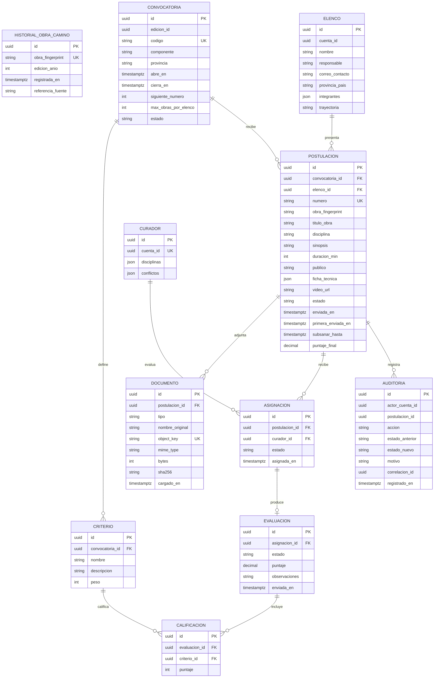

# Data Model: Convocatorias y curaduría (003)

Esquema PostgreSQL **`convocatorias`**, propiedad exclusiva del módulo y separada de los esquemas de las demás specs (Constitución III, ADR-0001). UUIDs de cuenta, edición y obra relacionados con otros contextos se almacenan como referencias escalares; no se crean FK ni lecturas cruzadas.

### historial_obra_camino

- Esta tabla es el registro propio de Convocatorias para RN-005. Conserva `obra_fingerprint`, edición/año en que se presentó y fecha de registro; sus filas se cargan desde un conjunto histórico curado, sin FK ni lecturas a otros contextos.
- La decisión de admisibilidad cruza `(convocatoria_id, obra_fingerprint)` con este registro únicamente para convocatorias del componente Camino a Loja.
## Entidades, restricciones e invariantes

### convocatoria

- `codigo` es único y determina el prefijo de folio; `edicion_id` no crea una FK externa.
- La P1 solo requiere consultar la convocatoria semillada y comprobar que está abierta en `[abreEn, cierraEn]` según reloj del servidor. Las mutaciones de configuración están fuera de alcance.
- En P1 no se guarda snapshot del criterio: `criterio_id` apunta al criterio semillado, que no tiene API de edición en este alcance. RN-007 declara: “Criterios y pesos son inmutables una vez recibida la primera postulación” (`spec.md`, RN-007). Esto mantiene estable nombre/peso mientras se evalúan postulaciones. Si una fase futura permite cambios/versionado, se añadirá snapshot en `CALIFICACION` antes de exponer esa mutación.

### elenco y postulación

- `elenco.cuenta_id` mapea al sujeto autenticado; no se replica la cuenta/credenciales.
- Una postulación corresponde a un elenco y una convocatoria. `obra_fingerprint` es SHA-256 de la representación canónica JSON (UTF-8) de título, disciplina, duración, sinopsis normalizados Unicode NFC, espacios internos colapsados y minúsculas; los campos se ordenan por nombre antes de serializar. Se excluye el elenco para detectar una misma ficha de obra presentada por más de un perfil. La regla única `(convocatoria_id, obra_fingerprint)` evita duplicados con contenido equivalente; cambios sustanciales en título/sinopsis crean otra huella y la detección editorial de obras equivalentes no se automatiza en P1.
- `max_obras_por_elenco` vive en la convocatoria semillada y se valida contando una vez cada postulación del elenco que haya tenido un primer envío (`primera_enviada_en`), incluso si luego volvió a borrador para editarla; un borrador nunca enviado no consume cupo. La spec solo dice “hasta el máximo de la convocatoria” (`spec.md`, Edge Cases); no fija cifra. Para la demo se semilla 3 como dato de convocatoria, no como regla general de producto.
- `numero` es único dentro de convocatoria, generado transaccionalmente con contador y formato `{codigo}-{anio}-{secuencia:04}`.
- Perfil, ficha y documentos pueden guardarse como borrador. Enviar requiere todos los campos y tipos documentales marcados obligatorios por los datos semillados.
- El conjunto cerrado de estados de postulación es `borrador`, `enviada`, `requiere_subsanacion`, `no_admitida`, `admitida`, `en_evaluacion`, `evaluada`, `requiere_deliberacion`, `seleccionada`, `lista_espera`, `no_seleccionada` y `desistida`. Los últimos cuatro de decisión/resultado se conservan para compatibilidad con el ciclo completo de la spec, pero las transiciones a ellos pertenecen a US4 fuera de alcance.
- Transiciones de postulación incluidas: `borrador → enviada` (ficha completa y convocatoria abierta); `enviada → borrador` si el elenco retira antes del cierre; `enviada → requiere_subsanacion | no_admitida | admitida`; `requiere_subsanacion → enviada` dentro de 72 h o `no_admitida` al vencer; `admitida → en_evaluacion`; `en_evaluacion → evaluada` al completar todas las evaluaciones; `evaluada → requiere_deliberacion` cuando dispersión >25; `evaluada | requiere_deliberacion → en_evaluacion` si coordinación reabre una evaluación con motivo. Cualquier transición no listada se rechaza.
- Transiciones de resultados conservadas para el ciclo completo, fuera de esta implementación P1: `evaluada → seleccionada` dentro del cupo; `evaluada → lista_espera` si queda en reserva; `evaluada → no_seleccionada` fuera de cupo; `lista_espera → seleccionada` por desistimiento de una seleccionada; `seleccionada → desistida` por desistimiento del elenco.
- El API de lectura del postulante filtra por `cuenta_id`; el panel de coordinación y curador aplica permisos por puerto de autorización.

### documentos

- Solo se persisten metadatos y una key S3 aleatoria; no hay URLs públicas ni keys derivadas de IDs secuenciales.
- Límite por archivo 10 MB (10 000 000 bytes); formatos admitidos PDF, JPEG o PNG (el FR-004 dice “PDF o imagen, máximo 10 MB por archivo”); se comprueba firma mágica y ClamAV debe dar resultado limpio. `video_url` solo admite URL HTTPS a plataforma externa.
- Descarga: localizar documento dentro de una postulación autorizada, comprobar dueño o permiso de coordinación/curador asignado y emitir URL firmada de lectura por 5 minutos. Nunca se entrega URL firmada antes de la autorización.
- El archivo se borra del storage si la transacción de metadatos falla; no se elimina metadata de auditoría.

### curador, asignación, evaluación y calificación

- `curador.cuenta_id` único y las asignaciones se crean para fixtures; no hay endpoint de asignación automática en scope.
- El conjunto cerrado de estados de asignación es `asignada`, `en_evaluacion`, `completada` y `reasignada`. Transiciones: `asignada → en_evaluacion` al iniciar borrador; `asignada | en_evaluacion → reasignada` solo por coordinación antes de completar; `en_evaluacion → completada` al enviar; `completada → en_evaluacion` cuando coordinación reabre evaluación con motivo. Un cambio de curador crea nueva asignación y conserva la anterior como `reasignada`.
- Unicidad `(postulacion_id, curador_id)` impide duplicar asignación activa. El conflicto de interés se registra y bloquea asignación/evaluación.
- Cada evaluación solo expone al curador la propia hasta que la envía; la consulta individual no devuelve evaluaciones ajenas.
- El conjunto cerrado de estados de evaluación es `borrador`, `enviada` y `reabierta`. Transiciones: `borrador → enviada`; `enviada → reabierta` solo coordinación con motivo; `reabierta → enviada`. No se permite editar una enviada sin reapertura.
- Puntaje de criterio entero 0–100. Puntaje de evaluación = Σ(puntaje × peso)/100, calculado exacto y redondeado half-up a dos decimales. Puntaje final es promedio de evaluaciones enviadas. La diferencia máximo-mínimo `>25` marca la postulación `requiere_deliberacion`; no se publica decisión de selección en el scope P1.

### auditoría y eventos

- `auditoria` es append-only para cambios de estado, petición/fin de subsanación, envío/retiro y envío/reapertura de evaluación. Guarda actor, instante, motivo y correlación.
- Política de retención de RNF-003: no se permite UPDATE/DELETE de filas de `AUDITORIA`; no existe tarea, endpoint ni job de purga. Los registros se conservan sin purga automática y, como mínimo, durante cinco años. Cualquier política futura de disposición requiere revisión explícita de cumplimiento y fuera de esta entrega.
- Las transiciones que publican evento insertan el evento en pg-boss dentro de la misma transacción de negocio (ADR-0003). El consumidor de Identidad registra idempotencia.

## Índices y restricciones de base

- Unique `(convocatoria_id, numero)` y `(convocatoria_id, obra_fingerprint)`.
- Índices `(estado, subsanar_hasta)`, `(cuenta_id, convocatoria_id)` en las relaciones necesarias y `(postulacion_id, estado)` para paneles.
- Unique `(postulacion_id, curador_id)`, `(evaluacion_id, criterio_id)` y `object_key`.
- Los `CHECK` de rango y conjunto cerrado de estados se crean explícitamente con SQL en la migración de Prisma, porque el schema Prisma no declara CHECK constraints. Incluyen peso `1..100`, puntaje `0..100`, bytes `1..10000000`, duración positiva y enums textuales permitidos para convocatoria, postulación, asignación y evaluación.

## Datos de demo (seed idempotente)

Un módulo seed independiente carga convocatoria abierta con criterios 50/30/20; perfiles ficticios; postulaciones en estados permitidos (borrador, enviada, requiere_subsanacion, no_admitida, admitida, en_evaluacion, evaluada y requiere_deliberacion); asignaciones en estados `asignada`, `en_evaluacion`, `completada` y `reasignada`; evaluaciones en estados `borrador`, `enviada` y `reabierta`; y documentos de ejemplo compatibles. El seed sube los objetos binarios ficticios a MinIO y guarda sus keys para que la descarga autorizada aplique en la demo. Usa `upsert`/constraints estables para repetición y no toca las semillas de otras specs. No incluye documentos personales ni datos reales.

## Trazabilidad de reglas y transiciones a `spec.md`

| Diseño / transición | Pasaje de respaldo |
|---|---|
| `borrador → enviada` | El ciclo dice “Envía con todo completo (convocatoria abierta)” y “Enviada” (`spec.md`, línea 244); US1-AS1 confirma envío con folio (líneas 49–52). |
| `enviada → borrador` antes del cierre | US1-AS4: “puede retirarla a borrador, editarla y reenviarla; el número se mantiene” (`spec.md`, líneas 55–56); ciclo, línea 245. |
| `enviada → requiere_subsanacion` | Ciclo: “Coordinación pide corrección” y “Requiere subsanación” (`spec.md`, línea 246); plazo “72 horas” (US2-AS1, línea 77). |
| `requiere_subsanacion → enviada` dentro del plazo | Ciclo: “Corrige en plazo” y “Enviada” (`spec.md`, línea 247); US2-AS2, líneas 78–79. |
| `requiere_subsanacion → no_admitida` al vencer | Ciclo: “Vence plazo” y “No admitida” (`spec.md`, línea 248); US2-AS3, líneas 80–81. |
| `enviada → no_admitida` | Ciclo: “No cumple requisitos” y “No admitida” (`spec.md`, línea 249); FR-006 exige motivo (líneas 203–204). |
| `enviada → admitida → en_evaluacion` | Ciclo: “Cumple requisitos” y “Admitida → En evaluación” (`spec.md`, línea 250). |
| `en_evaluacion → evaluada` | Ciclo: “Todas las evaluaciones enviadas” y “Evaluada” (`spec.md`, línea 251); US3 dice que al enviar la evaluación queda cerrada (líneas 89–90). |
| `evaluada → requiere_deliberacion` | US3-AS5: “dos puntajes que difieren más de 25 puntos” y la postulación se marca “requiere deliberación” (`spec.md`, líneas 106–107); FR-010, líneas 210–211. |
| evaluación `enviada → reabierta → enviada` | US3-AS6: “solo la coordinación puede reabrirla, con motivo registrado” (`spec.md`, línea 109). |
| asignación `asignada → en_evaluacion → completada` | US3: cada curador “revisa materiales, califica cada criterio y escribe observaciones; al enviar, su evaluación queda cerrada” (`spec.md`, líneas 89–90); Independent Test asigna dos curadores (línea 94). |
| asignación `asignada/en_evaluacion → reasignada` | Edge Case: “Un curador no termina en plazo: la coordinación reasigna sus postulaciones pendientes” (`spec.md`, línea 183). |
| `evaluada → seleccionada/lista_espera/no_seleccionada`, `lista_espera → seleccionada`, `seleccionada → desistida` (fuera de P1) | Ciclo de vida de selección y desistimiento (`spec.md`, líneas 252–256); US4 P2. |
| identidad de obra / `obra_fingerprint` | Edge Case: “La misma obra no puede postularse dos veces a la misma convocatoria” (`spec.md`, línea 185). El hash se calcula con la ficha canónica, según diseño de este plan. |
| límite por elenco | “Un elenco puede postular varias obras distintas, hasta el máximo de la convocatoria” (`spec.md`, Edge Cases, línea 186); la cifra no está definida y se configura en el fixture. |
| plazo de subsanación | US2-AS1: “un plazo de 72 horas” (`spec.md`, línea 77). |
| límite y formatos | FR-004: “PDF o imagen, máximo 10 MB por archivo” (`spec.md`, líneas 200–201); Edge Case de archivo con virus o formato no permitido, línea 187. PDF/JPEG/PNG concretan el tipo amplio “imagen”. |
