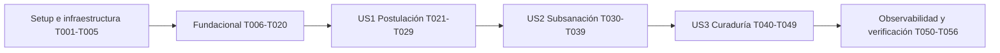

# Tasks: Convocatorias y curaduría

**Input**: Diseño de [spec.md](spec.md), [plan.md](plan.md), [research.md](research.md), [data-model.md](data-model.md), [contracts/](contracts/) y [quickstart.md](quickstart.md).

**Alcance**: US1 postulación, US2 admisibilidad/subsanación y US3 evaluación ponderada. US4–US6 y CRUD de US5 quedan fuera.

**FR-007 parcial en P1**: T041/T045 solo previenen conflictos de interés. El balanceo de carga se difiere; las asignaciones de curadores para la demostración vienen del seed y no se implementa asignación manual/automática en esta fase.

**Pruebas**: obligatorias según Principio IV. Primero se escriben las pruebas de dominio, integración y contrato para reglas críticas. Cada escenario aplicable mantiene su ID (`USn-ASm`) en el nombre o descripción; cobertura del dominio ≥80 %.

**Formato**: `[ID] [P?] [USn] Descripción`; `[P]` indica archivos distintos y sin dependencias pendientes.

## Phase 1: Setup e infraestructura compartida

**Purpose**: Registrar el schema, almacenamiento local, contratos, módulo e inicialización de datos sin modificar implementaciones de otras specs.

- [x] T001 Añadir `convocatorias` a `datasource db.schemas` en `prisma/schema/schema.prisma`, crear `prisma/schema/convocatorias.prisma` y migración inicial con CHECK SQL (`bytes BETWEEN 1 AND 10000000` y estados cerrados); verificar `pnpm db:migrate && pnpm db:generate`.
- [x] T002 [P] Añadir únicamente `@aws-sdk/client-s3` y `@aws-sdk/s3-request-presigner` a `apps/api/package.json`/`pnpm-lock.yaml`, y configuración `CONVOCATORIAS_ALMACENAMIENTO=disco`, `CONVOCATORIAS_DISCO_DIRECTORIO=.almacen-dev`, `CONVOCATORIAS_ANTIVIRUS=simulador` y variables S3/ClamAV sin secretos a `.env.example`. Compose conserva ClamAV solo bajo profile `antivirus`; no se agrega backend de objetos ni servicios/pasos CI. Excluir `.almacen-dev/` del repositorio. Probar configuración y `docker compose config`.
- [x] T003 [P] Crear `packages/contracts/src/eventos/convocatorias.ts` para `PostulacionEnviada` y `SubsanacionSolicitada`, exportarlos aditivamente en `packages/contracts/src/index.ts`; prueba Zod con cargas válidas e inválidas y sobre de evento común.
- [x] T004 Registrar `ConvocatoriasModule` en `apps/api/src/app.module.ts` y crear el esqueleto `domain/application/infrastructure/interface`; prueba de módulo/API confirma inicialización sin acceder a tablas de otros contextos.
- [x] T005 Crear `prisma/seed/convocatorias.ts` e invocarlo aditivamente desde `prisma/seed/index.ts`; prueba de integración corre seed dos veces con almacenamiento en memoria, verifica idempotencia, estados fixture, una obra en `HISTORIAL_OBRA_CAMINO` y lectura de documentos de ejemplo vía `AlmacenamientoDocumentosPort`. Campos canónicos según [data-model.md](data-model.md): CONVOCATORIA.codigo, POSTULACION.estado, HISTORIAL_OBRA_CAMINO.obra_fingerprint, DOCUMENTO.object_key.

**Checkpoint**: migración/generación Prisma, contratos y arranque del módulo listos; seed idempotente con documentos demo.

## Phase 2: Foundational - reglas, puertos y adaptadores

**Purpose**: Implementar primero los invariantes compartidos por las tres historias y los puertos de almacenamiento, antivirus y autorización.

### Pruebas primero

- [x] T006 [P] Pruebas de tabla de transición para el conjunto cerrado de estados de postulación, asignación y evaluación en `apps/api/src/modules/convocatorias/domain/estados.test.ts`; incluye transiciones válidas/inválidas y `enviada → borrador` solo antes del cierre. Campos canónicos según [data-model.md](data-model.md): POSTULACION.estado, ASIGNACION.estado, EVALUACION.estado.
- [x] T007 [P] Pruebas puras de `calcularObraFingerprint`, `puedePostularOtraObra`, `calcularPuntajePonderado` y `calcularResultadoCuraduria` en `apps/api/src/modules/convocatorias/domain/reglas-convocatoria.test.ts`; verifica canonicalización, máximo de fixture, 79,00, promedio 82,00 y umbral estrictamente >25. Campos canónicos según [data-model.md](data-model.md): POSTULACION.obra_fingerprint, CONVOCATORIA.max_obras_por_elenco, CRITERIO.peso, CALIFICACION.puntaje, EVALUACION.puntaje, POSTULACION.puntaje_final.
- [x] T008 [P] Pruebas de validación de documentos en `apps/api/src/modules/convocatorias/domain/documentos.test.ts`: PDF/JPEG/PNG y firmas válidas; tipo/MIME/firma inválidos; 10 000 000 bytes aceptados y 10 000 001 rechazados. Campos canónicos según [data-model.md](data-model.md): DOCUMENTO.tipo, DOCUMENTO.mime_type, DOCUMENTO.bytes, DOCUMENTO.sha256.
- [x] T009 [P] Pruebas del falso antivirus configurable en `apps/api/src/modules/convocatorias/infrastructure/escaner-antivirus-falso.test.ts`: `limpio` acepta; `infectado` rechaza; `caido` rechaza por fail-closed; los dos rechazos no persisten objeto ni metadatos.
- [x] T010 [P] Pruebas de autorización en `apps/api/src/modules/convocatorias/infrastructure/autorizacion-dev.adapter.test.ts`: roles canónicos FR-019, cuenta faltante, producción fail-closed, coordinación provincial fuera de alcance y curador limitado a asignaciones propias.
- [x] T011 [P] Pruebas unitarias de `puedeDescargarDocumento` y validación de `rol + asignación/propiedad` en `apps/api/src/modules/convocatorias/domain/permisos.test.ts`; coordinador, postulante propietario y curador asignado permiten, otros reciben rechazo. Campos canónicos según [data-model.md](data-model.md): ELENCO.cuenta_id, POSTULACION.elenco_id, CURADOR.cuenta_id, ASIGNACION.curador_id.

### Implementación fundacional

- [x] T012 Implementar tipos, enums cerrados y `transicionarPostulacion`, `transicionarAsignacion` y `transicionarEvaluacion` en `apps/api/src/modules/convocatorias/domain/` (hace pasar T006). Campos canónicos según [data-model.md](data-model.md): CONVOCATORIA.estado, POSTULACION.estado, ASIGNACION.estado, EVALUACION.estado.
- [x] T013 [P] Implementar fingerprint canónico SHA-256, límite de obras, aritmética decimal exacta, promedio y deliberación en `domain/reglas-convocatoria.ts` (hace pasar T007). Campos canónicos según [data-model.md](data-model.md): POSTULACION.obra_fingerprint, CONVOCATORIA.max_obras_por_elenco.
- [x] T014 [P] Implementar validador de campos, formato/firma y tamaño máximo 10 000 000 bytes en `domain/documentos.ts` (hace pasar T008). Campos canónicos según [data-model.md](data-model.md): DOCUMENTO.tipo, DOCUMENTO.mime_type, DOCUMENTO.bytes.
- [x] T015 Definir `RepositorioConvocatoriasPort`, `AlmacenamientoDocumentosPort`, `EscanerAntivirusPort`, `AutorizacionConvocatoriasPort`, reloj y publicador de eventos en `application/puertos.ts`; prueba de contratos de puertos/adaptadores sin dependencias cruzadas.
- [x] T016 [P] Implementar `FalsoEscanerAntivirus` configurable y adaptador ClamAV TCP bajo el puerto; test de contrato repite T009 para ambos resultados fallidos y comprueba rechazo si el real está caído.
- [x] T017 Implementar adaptadores de almacenamiento en memoria, disco `.almacen-dev/` y S3 para upload/delete/lectura y URLs firmadas de descarga por 5 minutos; probar memoria/disco con integración local (archivo temporal, firma, expiración y key opaca). Para S3, probar requests y firma con cliente AWS SDK simulado; no probar contra backend real en este entorno. Campos canónicos según [data-model.md](data-model.md): DOCUMENTO.object_key, DOCUMENTO.bytes, DOCUMENTO.mime_type, DOCUMENTO.sha256.
- [x] T018 Implementar `AutorizacionConvocatoriasDevAdapter` y guardas de rol/alcance según [autorizacion-identidad.md](contracts/autorizacion-identidad.md), sin editar archivos de Boletería; hace pasar T010–T011.
- [x] T019 Implementar repositorio Prisma, restricciones/índices y persistencia append-only de auditoría; pruebas de integración verifican CHECK SQL, unique constraints, que UPDATE/DELETE de `AUDITORIA` sean rechazados y que no exista operación/job de purga antes de cinco años. Verificar compensación de escritura con almacenamiento falso/memoria si falla la transacción DB. Campos canónicos según [data-model.md](data-model.md): CONVOCATORIA.codigo, POSTULACION.numero, POSTULACION.obra_fingerprint, DOCUMENTO.object_key, DOCUMENTO.bytes, ASIGNACION.postulacion_id, ASIGNACION.curador_id, EVALUACION.asignacion_id, CALIFICACION.evaluacion_id, CALIFICACION.criterio_id, AUDITORIA.actor_cuenta_id, AUDITORIA.correlacion_id, AUDITORIA.accion, AUDITORIA.estado_anterior, AUDITORIA.estado_nuevo, AUDITORIA.motivo.
- [x] T020 Implementar publicación transaccional pg-boss de `PostulacionEnviada` y `SubsanacionSolicitada`, reutilizando el patrón de contexto transaccional y publicación de Boletería (`apps/api/src/common/datos/transaccion.ts` y `apps/api/src/modules/boleteria/infrastructure/publicador.pgboss.ts`) sin modificar esos archivos; prueba de contrato/outbox comprueba esquema, `correlacionId`, idempotencia y rollback conjunto con la transacción. Campos canónicos según [data-model.md](data-model.md): AUDITORIA.correlacion_id.

**Checkpoint**: reglas puras cubiertas, tres modos falsos del antivirus probados, adaptadores privados y contratos listos.

## Phase 3: User Story 1 - Postular una propuesta artística (P1)

**Goal**: Guardar y enviar una propuesta completa, recibir folio único y gestionar documentos privados.

### Tests for User Story 1

- [x] T021 [P] [US1] Prueba unitaria `US1-AS2` de faltantes de perfil/ficha/documentos; el intento de enviar conserva el borrador y devuelve requisitos faltantes. Campos canónicos según [data-model.md](data-model.md): ELENCO.cuenta_id, POSTULACION.estado.
- [x] T022 [P] [US1] Prueba de integración `US1-AS1`, `US1-AS3`, `US1-AS4`, `US1-AS5`: envío con folio único; cierre impide enviar/editar; retiro antes del cierre conserva número al reenviar; según US1-AS5 acepta 31 de julio a las 23:59:30 y rechaza 1 de agosto a las 00:00:01 (fechas y horas literales de `spec.md`, sin asumir zona distinta de America/Guayaquil). Campos canónicos según [data-model.md](data-model.md): CONVOCATORIA.abre_en, CONVOCATORIA.cierra_en, POSTULACION.numero, POSTULACION.estado, POSTULACION.primera_enviada_en.
- [x] T023 [P] [US1] Prueba de integración para FR-004/edge cases: formatos válidos, virus, MIME falso, límites exactos 10 000 000/10 000 001, links de video, mismo `obra_fingerprint` duplicado y máximo de obras por elenco. Campos canónicos según [data-model.md](data-model.md): DOCUMENTO.tipo, DOCUMENTO.mime_type, DOCUMENTO.bytes, POSTULACION.obra_fingerprint, CONVOCATORIA.max_obras_por_elenco. Campos canónicos según [data-model.md](data-model.md): POSTULACION.video_url.
- [x] T024 [P] [US1] Prueba de integración de documento privado: `US1` postulante propietario puede solicitar URL firmada; otra cuenta no puede; key aleatoria y URL vence a 5 min. Campos canónicos según [data-model.md](data-model.md): DOCUMENTO.object_key, ELENCO.cuenta_id, POSTULACION.elenco_id, ASIGNACION.curador_id.
- [x] T025 [P] [US1] Prueba E2E de los flujos `US1-AS1`, `US1-AS2` y `US1-AS4` en `apps/web/e2e/convocatorias-postulacion.spec.ts`: navegar convocatoria pública, conservar borrador con faltantes, cargar documentos, enviar, comprobar acuse con número único (FR-005), descargar copia (FR-016) y retirar/reenviar con axe en móvil y escritorio. Cierre y horas límite `US1-AS3`/`US1-AS5` se verifican en la integración T022. Campos canónicos según [data-model.md](data-model.md): POSTULACION.numero, POSTULACION.estado, DOCUMENTO.object_key.

### Implementation for User Story 1

- [x] T026 [US1] Implementar casos de uso de crear elenco, crear/editar borrador, calcular faltantes, validar apertura/cierre, límite de obras y asignar folio transaccional en `application/postulaciones/`; hace pasar T021–T023. Campos canónicos según [data-model.md](data-model.md): CONVOCATORIA.codigo, CONVOCATORIA.abre_en, CONVOCATORIA.cierra_en, CONVOCATORIA.max_obras_por_elenco, POSTULACION.numero, POSTULACION.estado, POSTULACION.duracion_min.
- [x] T027 [US1] Implementar carga y descarga autorizada de documentos con validación, antivirus antes de S3, compensación ante fallo y URLs firmadas breves; hace pasar T023–T024. Campos canónicos según [data-model.md](data-model.md): DOCUMENTO.object_key, DOCUMENTO.mime_type, DOCUMENTO.bytes, DOCUMENTO.sha256, ELENCO.cuenta_id. Campos canónicos según [data-model.md](data-model.md): DOCUMENTO.object_key, DOCUMENTO.mime_type, DOCUMENTO.bytes, DOCUMENTO.sha256.
- [x] T028 [US1] Exponer consulta pública de convocatoria, CRUD permitido de perfil/ficha propia, enviar/retirar y documentos en controladores Zod/OpenAPI de `interface/`; hace pasar T022–T024. Campos canónicos según [data-model.md](data-model.md): CONVOCATORIA.estado, CONVOCATORIA.abre_en, CONVOCATORIA.cierra_en, POSTULACION.estado, POSTULACION.numero.
- [x] T029 [US1] Crear páginas móvil primero `/convocatorias`, `/convocatorias/{id}`, `/convocatorias/{id}/postular` y `/mis-postulaciones/{id}` con resumen accesible de errores, carga/descarga y acuse; hace pasar T025.

**Checkpoint**: postulación y documentos demostrables de punta a punta con folio estable y controles de acceso.

## Phase 4: User Story 2 - Revisión de admisibilidad y subsanación (P1)

**Goal**: Coordinación admite, rechaza o pide corrección; el elenco subsana dentro de 72 horas.

### Tests for User Story 2

- [x] T030 [P] [US2] Pruebas unitarias `US2-AS1`–`US2-AS3` de plazo exacto, transiciones, motivo obligatorio y vencimiento con reloj inyectado; vence exactamente a las 72 h. Campos canónicos según [data-model.md](data-model.md): POSTULACION.estado, POSTULACION.subsanar_hasta.
- [x] T031 [P] [US2] Prueba de integración `US2-AS1` y contrato de eventos: pedir subsanación conserva detalle/vencimiento, audita actor y publica `SubsanacionSolicitada` dentro de la transacción. Campos canónicos según [data-model.md](data-model.md): POSTULACION.estado, POSTULACION.subsanar_hasta, AUDITORIA.actor_cuenta_id, AUDITORIA.accion, AUDITORIA.motivo, AUDITORIA.correlacion_id.
- [x] T032 [P] [US2] Prueba de integración `US2-AS2`/`US2-AS3` y cierre de US2: reenvío dentro de plazo vuelve a `enviada` para revisión; coordinación admite después de revisar y queda `admitida` con auditoría; vencimiento del job idempotente deja `no_admitida` con motivo auditado. Campos canónicos según [data-model.md](data-model.md): POSTULACION.estado, POSTULACION.subsanar_hasta, AUDITORIA.estado_anterior, AUDITORIA.estado_nuevo, AUDITORIA.motivo.
- [x] T033 [P] [US2] Prueba de integración `US2-AS4`: una obra marcada previamente presentada en la tabla propia `HISTORIAL_OBRA_CAMINO` no queda admitida conforme RN-005; la prueba no consulta tablas, eventos ni proyecciones de otros contextos. Campos canónicos según [data-model.md](data-model.md): HISTORIAL_OBRA_CAMINO.obra_fingerprint, HISTORIAL_OBRA_CAMINO.edicion_anio.
- [x] T034 [P] [US2] Pruebas de autorización: `coordinación de convocatorias` puede admitir/no admitir/subsanar; `coordinación provincial` solo opera en la provincia de su alcance; rol postulante no puede ejecutar esas acciones.
- [x] T035 [P] [US2] Prueba E2E `US2-AS1`–`US2-AS4` en `apps/web/e2e/convocatorias-subsanacion.spec.ts`: solicitud, confirmar evento de aviso en outbox, corrección de documento, reenvío y expiración, con axe; no simular entrega de correo de Identidad. Campos canónicos según [data-model.md](data-model.md): POSTULACION.estado, POSTULACION.subsanar_hasta, DOCUMENTO.object_key, DOCUMENTO.bytes.

### Implementation for User Story 2

- [x] T036 [US2] Implementar casos de uso de admitir, no admitir, solicitar subsanación y completar correcciones con motivo obligatorio/auditoría; hace pasar T031–T034. Campos canónicos según [data-model.md](data-model.md): POSTULACION.estado, POSTULACION.subsanar_hasta, AUDITORIA.actor_cuenta_id, AUDITORIA.accion, AUDITORIA.motivo.
- [x] T037 [US2] Implementar expiración idempotente de 72 h mediante worker/pg-boss y rechazo Camino a Loja RN-005 consultando solo `HISTORIAL_OBRA_CAMINO`, dato propiedad de Convocatorias; registrar el consumidor/job con cambio aditivo en `apps/api/src/worker.module.ts`; hace pasar T032–T033. Campos canónicos según [data-model.md](data-model.md): POSTULACION.estado, POSTULACION.subsanar_hasta, POSTULACION.obra_fingerprint, HISTORIAL_OBRA_CAMINO.obra_fingerprint, AUDITORIA.registrado_en.
- [x] T038 [US2] Añadir endpoints/policies de panel y eventos a Identidad sin correo directo; hace pasar T031/T034.
- [x] T039 [US2] Crear interfaz de admisibilidad y vista del postulante para detalle de corrección, reloj límite y reemplazo de documento; hace pasar T035. Campos canónicos según [data-model.md](data-model.md): POSTULACION.subsanar_hasta, DOCUMENTO.object_key.

**Checkpoint**: solicitudes de subsanación, correcciones y vencimientos operan con auditoría y permiso por rol/alcance.

## Phase 5: User Story 3 - Evaluar postulaciones (P1)

**Goal**: Curadores asignados puntúan criterios ponderados sin ver puntajes ajenos; coordinación puede reabrir con motivo.

### Tests for User Story 3

- [x] T040 [P] [US3] Pruebas unitarias `US3-AS1`, `US3-AS2`, `US3-AS5`: puntaje 79,00, promedio 82,00, redondeo exacto y dispersión >25 (25 exactos no deliberan). Campos canónicos según [data-model.md](data-model.md): CRITERIO.peso, CALIFICACION.puntaje, EVALUACION.puntaje, POSTULACION.puntaje_final.
- [x] T041 [P] [US3] Pruebas de integración `US3-AS3`: conflicto por integrante, familiar declarado o representante impide asignar/evaluar al curador. Este caso cubre la parte de conflicto de FR-007; balanceo de carga queda diferido y las asignaciones vienen del seed. Campos canónicos según [data-model.md](data-model.md): ELENCO.integrantes, CURADOR.conflictos, ASIGNACION.postulacion_id, ASIGNACION.curador_id.
- [x] T042 [P] [US3] Prueba de integración `US3-AS4`: antes de enviar, la sesión del curador no recibe puntajes ajenos; coordinación puede consultar el agregado calculado. Campos canónicos según [data-model.md](data-model.md): ASIGNACION.curador_id, EVALUACION.asignacion_id, EVALUACION.estado, EVALUACION.puntaje.
- [x] T043 [P] [US3] Prueba de integración `US3-AS6`: evaluación enviada es inmutable al curador; coordinación con rol válido debe aportar motivo para reabrir; audita y permite nuevo envío. Campos canónicos según [data-model.md](data-model.md): EVALUACION.estado, EVALUACION.enviada_en, AUDITORIA.actor_cuenta_id, AUDITORIA.motivo, AUDITORIA.estado_anterior, AUDITORIA.estado_nuevo.
- [x] T044 [P] [US3] Prueba E2E `US3-AS1`–`US3-AS6` en `apps/web/e2e/convocatorias-curaduria.spec.ts`: ingreso por asignación, criterios, envío, ocultamiento, deliberación, conflicto y reapertura con axe. Campos canónicos según [data-model.md](data-model.md): ASIGNACION.curador_id, EVALUACION.estado, EVALUACION.puntaje, CALIFICACION.puntaje, POSTULACION.puntaje_final.

### Implementation for User Story 3

- [x] T045 [US3] Implementar consulta de asignaciones propias, políticas anti-conflicto y lectura filtrada que nunca proyecte puntuaciones ajenas al curador; no implementar balanceo ni alta de asignaciones en P1, que vienen del seed; hace pasar T041–T042. Campos canónicos según [data-model.md](data-model.md): ASIGNACION.postulacion_id, ASIGNACION.curador_id, ASIGNACION.estado, CURADOR.cuenta_id.
- [x] T046 [US3] Implementar guardado/envío de evaluación, agregación exacta, promedio y transición a `evaluada`/`requiere_deliberacion`; hace pasar T040–T042. Campos canónicos según [data-model.md](data-model.md): CRITERIO.peso, CALIFICACION.criterio_id, CALIFICACION.puntaje, EVALUACION.puntaje, POSTULACION.puntaje_final, POSTULACION.estado.
- [x] T047 [US3] Implementar reapertura exclusiva de coordinación con motivo y auditoría, reentrada a `en_evaluacion` y recálculo al reenviar; hace pasar T043. Campos canónicos según [data-model.md](data-model.md): EVALUACION.estado, EVALUACION.enviada_en, POSTULACION.estado, AUDITORIA.motivo.
- [x] T048 [US3] Exponer endpoints de curaduría/reapertura en API con autorización y Zod; hace pasar T041–T043. Campos canónicos según [data-model.md](data-model.md): EVALUACION.estado, POSTULACION.estado, AUDITORIA.motivo.
- [x] T049 [US3] Crear panel accesible de curaduría con asignaciones, material autorizado, formulario de criterios y confirmación de envío; hace pasar T044.

**Checkpoint**: las tres historias P1 cumplen sus escenarios y se pueden demostrar independientemente.

## Phase 6: Observabilidad y verificación final

**Purpose**: Cerrar calidad y recorrido de despliegue local antes de analyze/revisión posterior.

- [ ] T050 Añadir observabilidad del módulo: logs estructurados con `correlacionId` en casos de uso, adaptadores y worker; métricas del módulo para envíos, fallos de validación/antivirus, subsanaciones, expiraciones, evaluaciones y latencia; prueba verifica propagación de correlación y registro de métricas sin datos personales. Campos canónicos según [data-model.md](data-model.md): AUDITORIA.correlacion_id.
- [ ] T051 Ejecutar `pnpm lint && pnpm typecheck`; corregir errores/advertencias nuevas y guardar resultado Q1.
- [ ] T052 Ejecutar `pnpm test`; comprobar cobertura ≥80 % de `apps/api/src/modules/convocatorias/domain/` y que el falso antivirus cubra limpio/infectado/caído (Q2).
- [ ] T053 Ejecutar `pnpm --filter @fiavl/api test:int`; confirmar PostgreSQL y adaptadores memoria/disco pasan sin ClamAV y registrar separadamente los dos fallos preexistentes documentados de Boletería, sin modificarlos.
- [ ] T054 Ejecutar E2E de US1–US3 y axe/WCAG 2.1 AA; verificar formularios móviles y teclado (Q7).
- [ ] T055 Seguir [quickstart.md](quickstart.md) completo: `pnpm db:up && pnpm db:migrate && pnpm db:generate && pnpm db:seed && pnpm dev`; comprobar seed repetible, almacenamiento local y las tres P1 demostrables. Ejecutar `npx --yes @redocly/cli@1.25.0 lint --extends=recommended specs/003-convocatorias-curaduria/contracts/api-convocatorias.openapi.yaml` y `python scripts/validar-mermaid.py`.
- [ ] T056 Revisar contratos/eventos y permisos Q3/Q8, diff aditivo de archivos compartidos y ausencia de secretos; registrar cualquier cambio de arquitectura/documentación requerido para rama `docs/...`.

## Dependencies & Execution Order

- Setup inicia en cuanto se aprueben tasks; la fase fundacional bloquea las historias.
- Cada historia sigue pruebas → dominio/casos de uso → adaptadores/API → interfaz E2E.
- La verificación final usa memoria/disco y el falso antivirus; S3 usa cliente simulado y queda pendiente de smoke test en infraestructura real; ClamAV solo se prueba manualmente con profile opcional.
- No modificar `docs/arquitectura/`, `docs/adr/`, specs 001/002/004 ni archivos de Boletería.

## Notes

- `[P]` solo se usa cuando las tareas pueden hacerse en archivos distintos sin dependencias pendientes.
- Cada escenario Given/When/Then de las P1 debe aparecer en al menos una prueba automatizada con su ID.
- Las tareas no completadas se implementan en orden; esta lista no autoriza analyze ni implementación por sí sola.
