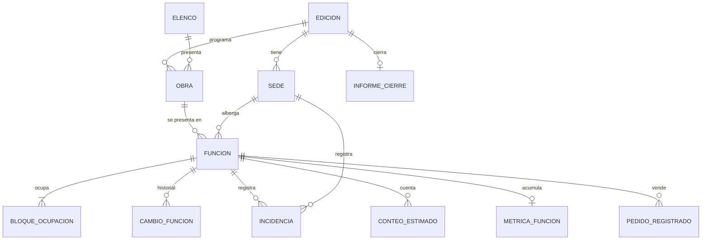
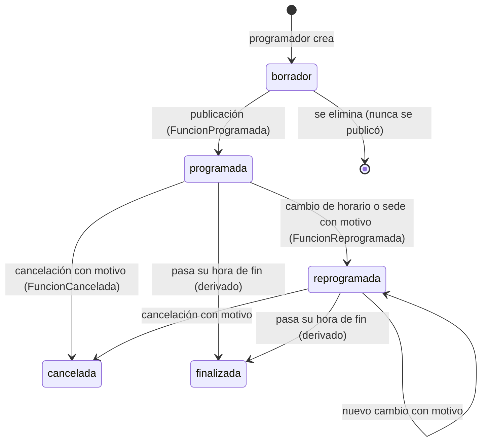
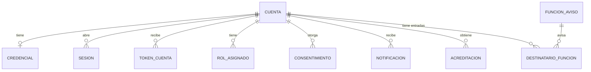
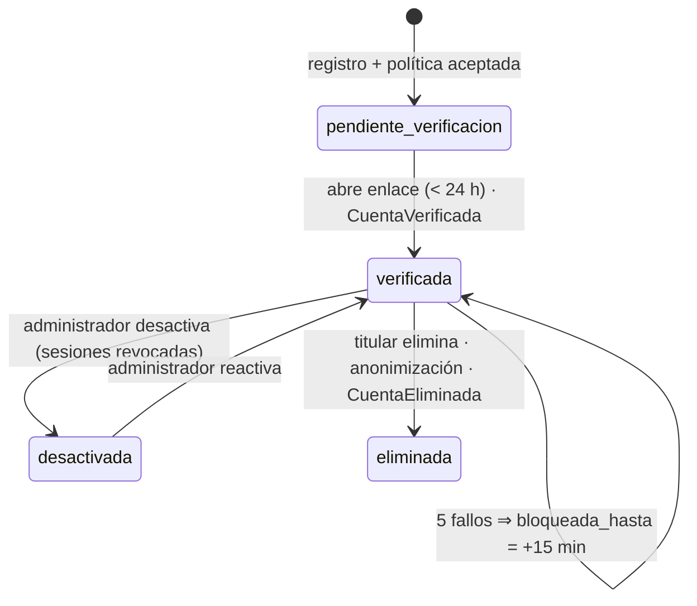

# Data Model: Gestión operativa, cuentas y notificaciones (004)

Dos esquemas PostgreSQL, cada uno **propiedad exclusiva** de su módulo (Constitución III,
[ADR-0001](../../docs/adr/0001-monolito-modular.md)): **`operacion`** y **`identidad`**. Ninguno lee
tablas de otro esquema; lo que necesitan de Boletería, Convocatorias o entre sí llega por eventos
([contracts/eventos-operacion-identidad.md](contracts/eventos-operacion-identidad.md)). Decisiones
de diseño en [research.md](research.md).

Convenciones (iguales a 001 y 002): ids `uuid`; instantes `timestamptz` y día del festival en
`America/Guayaquil`; importes en **centavos enteros** (Constitución V); columnas `snake_case` con
`@map` en Prisma; archivos `prisma/schema/operacion.prisma` e `identidad.prisma`; `schemas` de
`schema.prisma` añade `"operacion", "identidad"` y `extensions` añade `btree_gist`.

---

## Esquema `operacion`



### `edicion`

| Campo | Tipo | Reglas |
|-------|------|--------|
| id | uuid PK | |
| numero | text | "XI" |
| anio | int | único |
| fecha_inicio, fecha_fin | date | `fecha_fin ≥ fecha_inicio`; fuera de noviembre → advertencia (US6-AS2) |
| pais_invitado | text? | |
| precio_centavos | int ≥ 0 | RN-006: cambiarlo no afecta pedidos existentes (Boletería congela el importe) |
| max_pagadas_persona, max_reservas_persona | int > 0 | parámetros de compra (FR-011) |
| estado | enum `planificacion` · `publicada` · `cerrada` | RN-007: `cerrada` ⇒ solo lectura |
| edicion_base_id | uuid? | edición de la que se copió (US6-AS1) |
| version | int | control optimista (R2) |
| creada_en, actualizada_en | timestamptz | |

### `sede`

| Campo | Tipo | Reglas |
|-------|------|--------|
| id | uuid PK | |
| edicion_id | uuid FK | las sedes son por edición (R9) |
| sede_origen_id | uuid? | sede equivalente de la edición anterior |
| nombre | text | único por edición |
| tipo | enum `TipoSede` del contrato | teatro, centro_cultural, museo, espacio_publico, recorrido |
| direccion | text | |
| lat, lng | double | |
| recorrido | jsonb? | puntos de paso (obligatorio si `tipo = recorrido`) |
| aforo | int? > 0 | obligatorio salvo `espacio_publico`/`recorrido` |
| accesibilidad | jsonb | `{ sillaRuedas, banoAccesible, rampa }` obligatoria (Constitución VII) |
| montaje_min | int ≥ 0 | por defecto 30 (FR-002) |
| horario_taquilla | jsonb? | |
| activa | boolean | no se elimina con funciones; solo se desactiva sin funciones futuras (US6-AS3) |
| version | int | |

### `elenco`

| Campo | Tipo | Reglas |
|-------|------|--------|
| id | uuid PK | |
| nombre | text | |
| pais, ciudad | text, text? | `pais` alimenta la dimensión "país" (US5) |
| origen | enum `invitado` · `convocatoria` | |
| postulacion_id | uuid? único | idempotencia de `PostulacionSeleccionada` |

### `obra`

| Campo | Tipo | Reglas |
|-------|------|--------|
| id | uuid PK | |
| edicion_id, elenco_id | uuid FK | |
| titulo, sinopsis | text | |
| disciplina, componente | enums del contrato | |
| duracion_min | int > 0 | base del cálculo de fin (RN-002) |
| edad_minima | int ≥ 0 | |
| idioma | text? | |
| imagenes | jsonb (urls) | publicación exige al menos una (R4) |
| ficha_artistica, ficha_tecnica | jsonb | la técnica llega de Convocatorias (US1-AS5) |
| estado | enum `disponible` · `desistida` | `desistida` ⇒ no programable (FR-007) |
| origen | enum `invitado` · `convocatoria` | |
| postulacion_id | uuid? único | |

### `funcion`

| Campo | Tipo | Reglas |
|-------|------|--------|
| id | uuid PK | |
| edicion_id, obra_id, sede_id | uuid FK | |
| elenco_id | uuid | copia de `obra.elenco_id` para la restricción de elenco (FR-003) |
| inicio, fin | timestamptz | `fin = inicio + duracion` al crear; editable **solo hacia más tiempo** (RN-002) |
| continua | boolean | actividades continuas: un bloque por día (R1) |
| tipo_acceso | enum `TipoAcceso` | |
| publico | enum `Publico` | |
| aforo_habilitado | int? > 0 | `≤ sede.aforo` (FR-004); `null` solo en acceso libre sin aforo |
| estado | enum `borrador` · `programada` · `reprogramada` · `cancelada` | `finalizada` se **deriva**: `fin < ahora` y no cancelada (R8) |
| version | int ≥ 1 | se incrementa en cada evento publicado; viaja en `FuncionDto.version` |
| publicada_en | timestamptz? | |
| creada_por | uuid | cuenta |
| creada_en, actualizada_en | timestamptz | |

Índices: `(edicion_id, inicio)`, `(sede_id, inicio)`, `(obra_id)`.

### `bloque_ocupacion` (garantía de cero cruces, R1)

| Campo | Tipo | Reglas |
|-------|------|--------|
| id | uuid PK | |
| funcion_id | uuid FK | |
| sede_id, elenco_id | uuid | |
| rango_sede | tstzrange | `[inicio, fin + montaje)` |
| rango_elenco | tstzrange | `[inicio, fin)` |
| activo | boolean | `false` al cancelar |

```sql
EXCLUDE USING gist (sede_id WITH =, rango_sede WITH &&) WHERE (activo)
EXCLUDE USING gist (elenco_id WITH =, rango_elenco WITH &&) WHERE (activo)
```

Se reescriben en la misma transacción que crea, reprograma o cancela la función. Las
restricciones se escriben a mano en la migración SQL (Prisma no modela `EXCLUDE`).

### `cambio_funcion` (historial, FR-006)

| Campo | Tipo | Reglas |
|-------|------|--------|
| id | uuid PK | solo inserción |
| funcion_id | uuid FK | |
| tipo | enum `reprogramacion` · `cambio_sede` · `cancelacion` · `cambio_aforo` · `edicion` | |
| anterior, nuevo | jsonb | valores anteriores y nuevos |
| motivo | text | **obligatorio** en reprogramación, cambio de sede y cancelación (US3-AS4) |
| exceso_confirmado | int? | entradas en exceso aceptadas (US3-AS2) |
| autor_id | uuid | |
| registrado_en | timestamptz | |

### `incidencia` (US4)

| Campo | Tipo | Reglas |
|-------|------|--------|
| id | uuid PK | |
| edicion_id, sede_id | uuid FK | |
| funcion_id | uuid? FK | |
| tipo | enum `retraso` · `falla_tecnica` · `clima` · `emergencia_medica` · `aforo_superado` · `conflicto_ingreso` · `desistimiento` · `otra` | |
| descripcion | text | |
| afecta_publico | boolean | si `true` la UI ofrece reprogramar (US4-AS2) |
| origen | enum `manual` · `automatica` | automáticas: `AforoExcedido`, `ConflictoDeIngreso`, `SeleccionDesistida` |
| evento_origen_id | uuid? único | idempotencia de incidencias automáticas (US4-AS3) |
| autor_id | uuid? | `null` si es automática |
| estado | enum `abierta` · `atendida` | |
| ocurrida_en | timestamptz | |

### `conteo_estimado` (US4-AS1, RN-004)

| Campo | Tipo | Reglas |
|-------|------|--------|
| id | uuid PK | solo inserción; el vigente es el último por función |
| funcion_id | uuid FK | solo funciones de acceso libre o en espacio público |
| cantidad | int ≥ 0 | |
| metodo | text | p. ej. "aforo visual", "por áreas" |
| autor_id | uuid | jefe de sala con alcance sobre la sede |
| registrado_en | timestamptz | |

### Proyecciones desde Boletería (R7)

| Tabla | Clave | Campos | Se alimenta con |
|-------|-------|--------|-----------------|
| `pedido_registrado` | pedido_id | funcion_id, tipo (`compra`/`reserva`), canal, cantidad, importe_centavos, reembolsado | `EntradasEmitidas`, `PedidoReembolsado` |
| `metrica_funcion` | funcion_id | entradas_emitidas, entradas_reembolsadas, ingresos_validados, recaudacion_centavos, actualizado_en | los tres eventos |
| `ingreso_registrado` | ingreso_id | funcion_id, escaneado_en | `IngresoRegistrado` (evita contar dos veces) |

`entradasActivas = emitidas − reembolsadas` (US3-AS2). `recaudacion = Σ importe compras − Σ
importe reembolsado`.

### Cierre y comparación (R8)

| Tabla | Campos |
|-------|--------|
| `informe_cierre` | edicion_id PK, generado_en, datos jsonb (cifras congeladas) |
| `cifras_historicas` | anio PK, actividades, elencos, obras, paises, asistencia_total, asistencia_validada?, asistencia_estimada?, ocupacion_media?, recaudacion_centavos? (semilla 2025: el desglose no se publicó) |

### Soporte

- `auditoria` (solo inserción; trigger que rechaza `UPDATE`/`DELETE`): id, accion, actor_id, rol,
  entidad, entidad_id, anterior jsonb, nuevo jsonb, correlacion_id, registrado_en (FR-012).
- `evento_procesado`: evento_id PK, tipo, procesado_en (consumidores idempotentes).

### Ciclo de vida de una función



RN-005: cancelar o reprogramar solo si `ahora < fin`. Edición `cerrada` ⇒ ninguna transición.

---

## Esquema `identidad`



### `cuenta`

| Campo | Tipo | Reglas |
|-------|------|--------|
| id | uuid PK | mismo `cuentaId` que usan Boletería y Cartelera |
| nombre | text | |
| correo | text **único** | normalizado: `trim` + minúsculas |
| estado | enum `pendiente_verificacion` · `verificada` · `desactivada` · `eliminada` | |
| verificada_en | timestamptz? | |
| bloqueada_hasta | timestamptz? | 5 fallos/15 min ⇒ +15 min (US8-AS2) |
| es_personal | boolean | derivado de tener un rol de personal; fija 8 h de sesión y exige TOTP |
| preferencias | jsonb | `{ novedades: boolean }` (FR-022) |
| creada_en, actualizada_en | timestamptz | |

"Bloqueada" no es un estado guardado sino `bloqueada_hasta > ahora` (vuelve sola a verificada).

### `credencial`

| Campo | Tipo | Reglas |
|-------|------|--------|
| cuenta_id | uuid PK FK | |
| hash_contrasena | text | `scrypt$N$r$p$sal$hash` (R10); nunca en logs |
| totp_secreto_cifrado | bytea? | AES-256-GCM (R13) |
| totp_activo | boolean | |
| totp_ultimo_paso | bigint? | evita reutilizar un código |
| actualizada_en | timestamptz | |

### `sesion` (R12)

| Campo | Tipo | Reglas |
|-------|------|--------|
| id | uuid PK | se muestra en "Mis sesiones" |
| cuenta_id | uuid FK | |
| hash_token | bytea único | SHA-256 del token de la cookie |
| dispositivo | text | descripción breve del agente de usuario |
| segundo_factor_ok | boolean | `false` ⇒ solo puede configurar/verificar TOTP |
| creada_en, ultima_actividad_en, expira_en | timestamptz | expiración deslizante 30 d / 8 h |
| revocada_en | timestamptz? | |

### `token_cuenta` (enlaces de un solo uso)

| Campo | Tipo | Reglas |
|-------|------|--------|
| id | uuid PK | |
| cuenta_id | uuid FK | |
| tipo | enum `verificacion` · `recuperacion` · `estudiante` | |
| hash_token | bytea único | |
| dato | jsonb? | p. ej. correo institucional a verificar |
| expira_en | timestamptz | 24 h verificación, 1 h recuperación (FR-017) |
| usado_en | timestamptz? | un solo uso |
| creado_en | timestamptz | máx. 3 de verificación por hora (caso borde) |

### `intento_acceso`

correo (normalizado), exito boolean, ocurrido_en. Índice `(correo, ocurrido_en)`; se depura a los 30 días.

### `rol_asignado` (FR-019, RN-009)

| Campo | Tipo | Reglas |
|-------|------|--------|
| id | uuid PK | |
| cuenta_id | uuid FK | |
| rol | enum de 11 roles (R16) | |
| alcance_tipo | enum `sede` · `provincia` · `disciplina` ? | obligatorio según el rol (caso borde) |
| alcance_valor | text? | id de sede, código de provincia o disciplina |
| asignado_por | uuid | |
| asignado_en | timestamptz | |
| revocado_en | timestamptz? | no se borra: queda el historial |

Único parcial `(cuenta_id, rol, alcance_valor) WHERE revocado_en IS NULL`.

### `documento_legal` y `consentimiento` (US7-AS5, US11-AS4)

- `documento_legal`: documento (`politica_privacidad`), version, vigente_desde, url. PK (documento, version).
- `consentimiento`: id, cuenta_id, documento (`politica_privacidad` · `novedades`), version,
  aceptado_en, retirado_en?. Solo inserción; el vigente es el último.

### `notificacion` (FR-021, RN-011)

| Campo | Tipo | Reglas |
|-------|------|--------|
| id | uuid PK | |
| cuenta_id | uuid? | `null` si solo hay correo (compra en taquilla con correo) |
| correo_destino | text | |
| plantilla | text | `entradas_emitidas`, `funcion_cancelada`, … |
| categoria | enum `servicio` · `opcional` | opcionales respetan preferencias |
| evento_origen_id | uuid? | |
| clave_dedup | text **única** | `tipoEvento:eventoId:destinatario` |
| datos | jsonb | variables de la plantilla (sin tokens de sesión ni contraseñas) |
| estado | enum `pendiente` · `enviada` · `fallida` · `omitida` | `omitida` = opcional desactivada |
| intentos | int | |
| ultimo_error | text? | |
| creada_en, enviada_en | timestamptz | `fallida` si no se envió en 24 h (US10-AS2) |

Los datos de entradas (`tokenQr`) solo se guardan mientras la notificación está pendiente y se
borran de `datos` al enviarse.

### Proyecciones para avisos

| Tabla | Clave | Campos | Se alimenta con |
|-------|-------|--------|-----------------|
| `funcion_aviso` | funcion_id | titulo, sede_nombre, inicio, fin, estado, version | `FuncionProgramada`, `FuncionActualizada`, `FuncionReprogramada`, `FuncionCancelada` |
| `destinatario_funcion` | pedido_id | funcion_id, cuenta_id?, correo?, activo | alta `EntradasEmitidas`, baja `PedidoReembolsado` |
| `postulacion_en_curso` | postulacion_id | cuenta_id, estado | `PostulacionEnviada`, `ResultadoPublicado` (US11-AS2) |
| `edicion_vigente` | edicion_id | fecha_fin | `ProgramacionPublicada` (RN-012) |

### Estudiantes (US12)

- `dominio_institucional`: dominio PK, institucion, creado_por, creado_en.
- `acreditacion`: id, cuenta_id, tipo (`estudiante`), evidencia (dominio verificado),
  vigente_hasta (= fin de la edición, RN-012).

### Soporte

`auditoria` (solo inserción, mismas columnas que en `operacion`; acciones FR-024: login del
personal, cambio de rol, restablecimiento de TOTP, desactivación, eliminación) y
`evento_procesado`.

### Ciclo de vida de una cuenta



### Anonimización (RN-010, US11-AS2)

En una transacción: `nombre = 'Cuenta eliminada'`, `correo = 'eliminada+<id>@anonimo.invalid'`,
`estado = eliminada`; se borran `credencial`, `sesion`, `token_cuenta`, `consentimiento` de
novedades, `destinatario_funcion`, `acreditacion`; en `notificacion` se reemplaza `correo_destino`
y se vacía `datos`. Se conservan `auditoria` y `rol_asignado` (sin datos personales).
